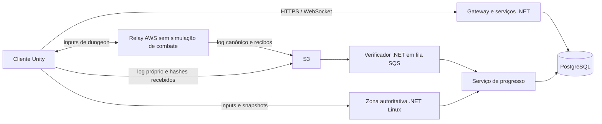

# Arquitetura de rede do AnimLab como MMO

**Estado:** proposta para decisão; sem implementação. **Data:** 31 de outubro de 2026. **Projeto:** `C:\Users\Martim\AnimLab`, Unity 6000.3.15f1 / URP. Documento em português; exemplos de texto apresentado ao jogador em inglês.

## 1. Decisão proposta e limites da evidência

Adotar um núcleo de regras C# partilhado por três executores: **mundo autoritativo .NET/Linux**, **dungeon cooperativa em rollback entre 2–5 clientes através de relay AWS**, e **verificador .NET que reproduz a dungeon antes de autorizar progresso**. O servidor continua a ser o único autor de personagens, inventário, moeda, XP e loot em ambos os modelos.

**A fase 6 do plano anterior, Steam P2P, está cancelada para esta arquitetura.** Os documentos `Netcode_Rollback.md` e `Netcode_Progress.md` permanecem como histórico do banco de combate. Este documento substitui a sua direção de produto; não os altera. Nenhum trabalho Steam é necessário para executar as fases abaixo.

Três limites condicionam a decisão:

- Um replay válido prova que uma sequência admitida de inputs produz um resultado permitido pelas regras. Não prova que houve input humano, ausência de automação, ausência de informação extra ou ausência de conluio entre todos os membros.
- Verificar 100% dos ticks depois da partida executa aproximadamente o mesmo trabalho de simulação que executá-los durante a partida. As poupanças possíveis vêm de processamento em lote/Spot, menor obrigação de latência e menor replicação; não de multiplicar a velocidade de replay.
- Segundo as fontes AWS consultadas, desde 15/06/2026 o tráfego de instâncias GameLift Servers elegíveis de geração 6 ou superior está incluído. Isso muda a comparação: relay EC2 com tráfego pago pode custar mais do que dungeons autoritativas em GameLift. Preservar a opção híbrida pedida, mas exigir a comparação económica da §9 antes de a tornar compromisso de produção. [S1][S2]

### 1.1 O que foi observado no projeto

| Evidência lida | Consequência para o plano |
|---|---|
| `Docs/Biblia.md`: sete elementos, estados, Avatar State, Bankai e Domain Expansion; o texto distingue visão e implementação | Os três poderes simultâneos precisam de estados de combate; Domain Expansion 1v1 dentro do MMO não transforma o jogo num produto de duelos |
| `Sim/World.cs`, `State.cs`, `CombatRules.cs`: 60 Hz, `P0/P1`, referências `1-id`, chão y=0, raio 20, cinco estilos | Há um núcleo de combate reutilizável, não uma simulação de mundo com entidades arbitrárias |
| `PlayerInput.WireSize=5`; `StateCodec.Version=3`; Q32.32; `Fix` usa `BigInteger` em multiplicação/divisão/raiz | Bons contratos determinísticos iniciais; custo e compatibilidade entre plataformas ainda precisam de medição para N entidades |
| `RollbackSession`: 128 estados, máximo 8 ticks, dois streams; checksums confirmados de 30 em 30 ticks | Reutilizar o algoritmo; generalizar armazenamento, confirmação e identidade; não aumentar apenas um tamanho de array |
| `MatchHandshake`: cada cliente propõe stats dentro de intervalos | Válido para laboratório; inadmissível como origem dos stats de um MMO |
| `Ability`, `AbilityBar`, projéteis e `DuelistAI` dependem de Unity, floats, relógio, física e/ou RNG locais | IA e habilidades precisam de separar regra determinística e apresentação |
| `Combatant` mantém estados, duração e resistências; `CharacterStats` e a hotbar usam `PlayerPrefs` | Estado persistente e validação das escolhas passam para o backend; o cliente apresenta uma cópia |
| Fogo e água chamam efetivamente `Combat.Explode`/`TakeHit`; vários outros efeitos são sobretudo visuais/física de objetos | Não assumir que a aparência de Lightning/Kirin/Thunder/tornados já define dano e regras completas |

O relatório anterior regista 39/39 testes e convergência Mono/CoreCLR e entre dois processos Windows. São **resultados históricos**, não testes executados para este plano, nem prova de Linux ARM64, IL2CPP, cinco peers, bosses, segurança ou capacidade MMO. A validação em dois PCs físicos era ainda pendente nesse relatório.

Durante a leitura apareceram alterações locais por gravar, incluindo `Steam/`, `SteamOnline.cs`, `SteamSmokeRun.cs`, `SteamEditorLifetime.cs`, `DatagramSession.cs` e alterações aos transportes, menu, assemblies e pacotes. Há assim código mais recente do que o progresso documentado. Foi apenas lido e fica preservado; a §10 inclui-o na migração planeada. Não se presume uma revisão atómica de ficheiros que estão a ser trabalhados em paralelo.

### 1.2 Proposta versus validação

Todos os limites de jogadores, tempos de CPU, taxas de tráfego e capacidades por máquina abaixo são **orçamentos para testar**, não medições deste projeto. As decisões recomendadas estão identificadas; as alternativas que mudam o produto/custo estão na §12. Não foi compilado, iniciado, testado ou publicado qualquer servidor nesta tarefa.

## 2. Fronteiras de autoridade

| Conteúdo | Executor do combate | Autoridade persistente | Limite inicial proposto |
|---|---|---|---|
| Mundo aberto e PvE público | Um processo de zona .NET | Backend + zona com lease válida | 100 jogadores por zona; §4.5 |
| Cidades | Zona .NET; IA reduzida onde não há combate | Backend | 150 jogadores, inicialmente 100 |
| PvP aberto, bosses públicos, conflitos entre grupos | Zona .NET | Zona e backend | Sem P2P, incluindo prémios de PvP |
| Dungeons cooperativas privadas | Todos os clientes simulam o mesmo estado via rollback | Backend, após verificação | Roster inicial de 2–5; até 32 mobs ativos |
| Dungeon competitiva, ranking com prémios, invasão de outro grupo | Recomendação: instância autoritativa | Backend | Fora do MVP P2P |
| Domain Expansion com adversário do mundo | Subinstância/arena autoritativa reservada pela zona | Backend | 2 participantes; preservar cooldowns e posse |
| Treino local/duelo de laboratório | Banco atual offline/rollback | Sem progresso MMO | Conservar para regressão |

Avatar State e Bankai são modificadores sobre a mesma entidade e o mesmo estado, acumuláveis segundo a Bíblia. Não criam cópias persistentes da personagem. A entrada num Domain exige regras de consentimento/CC e de saída; nunca pode servir para desligar PvP ou retirar um inimigo para um cliente autoritativo.



O gateway não retransmite todos os datagramas de combate. Autentica, reserva e fornece endpoints/tokens. O cliente liga diretamente ao processo de zona ou ao relay atribuído. A apresentação nunca envia `SetHealth`, `GiveItem` ou um snapshot a substituir a personagem do backend.

## 3. Estado da personagem, handoff e recuperação

### 3.1 Contratos de estado

Separar três categorias, com IDs estáveis e versões explícitas:

- **Persistente:** `AccountId`, `CharacterId`, nível/XP inteiros, atributos base/pontos, `TreeA/TreeB`, nós aprendidos, `StyleId`, hotbar de 9 `AbilityId`, equipamento, instâncias de itens com GUID/quantidade, moedas, quests e flags de progresso. A configuração de teclas e gráficos continua local. Não usar `displayName` como chave de habilidade.
- **Estado vivo autoritativo:** zona/canal, posição válida, HP/mana/postura, cooldowns, estados com expiração, ataque/cast em curso, relógios por corpo e efeitos de Avatar/Bankai. Stats derivados são calculados no servidor a partir das definições versionadas.
- **Estado exclusivo de execução:** inputs, snapshots de previsão/rollback, IA, RNG, projéteis e eventos. Não equivale a um save de inventário.

Contrato de entrada conceptual:

```text
RunManifest {
  runId, nonce, region, dungeonId, difficulty, roster[2..5], peerSlots,
  protocolVersion, inputSchemaVersion, simBuildHash, rulesHash, mapCollisionHash,
  initialStateHash, initialStateLocation, characterEntryVersions[], configRevision,
  gameplaySeed, lootSeedCommitment, escrowIds[], returnLocations[],
  tickRate=60, inputDelay, maxRollback=8, disconnectPolicyVersion,
  notBefore, startDeadline, maxSimulationTicks, maxWallDuration, relayAssignmentEpoch,
  signingKeyId, serverSignature
}
```

O estado inicial contém vitais/cooldowns/status válidos e a configuração calculada pelo servidor. A semente de gameplay é partilhada; a de loot fica secreta no backend. Uma assinatura do manifesto abrange a serialização binária canónica integral, incluindo hashes de conteúdo e política de abandono.

### 3.2 Fluxo mundo → dungeon

1. O líder pede entrada; cada membro confirma prontidão. O serviço valida conta, personagem, party, região, versão de build, acesso, lotação e latência até ao relay. Não basta o líder enviar a ficha dos outros.
2. A zona exige portal/safe point e ausência de combate nos últimos **10 s**. Reservar capacidade e criar `runId` idempotente. Uma personagem não pode estar em duas reservas ativas.
3. O backend reserva/coloca em escrow os itens autorizados, custos de entrada e loadout. A zona corta os inputs num tick definido, grava o estado de saída e emite um recibo interno. A personagem só deixa de existir no mundo quando essa posse estiver transferida duravelmente.
4. Máquina de estados persistente: `WorldResident → Reserved → Detached → InstanceActive`. Cada transição verifica versão e `ownerEpoch`. Se a reserva falha antes de `Detached`, continua no mundo. Depois disso, só o coordenador pode recuperar a posse.
5. Backend gera manifesto assinado e tokens separados por conta/peer/run. Os clientes carregam os mesmos dados e confirmam hashes. Deadline de preparação: **60 s**; sem todos prontos, cancelar e devolver a posse/escrow por transação idempotente.
6. O relay publica `Start` assinado, tick zero e âncora de tempo, depois de confirmar a posse. Só então começa o combate. O primeiro cliente não é host de regras, RNG, loot ou seleção de estado inicial.

Manter `CharacterOwner(characterId, locationKind, locationId, ownerEpoch)` no backend. Heartbeats pertencem ao processo/lease da zona ou run, não a uma escrita por personagem a cada tick. Uma lease expirada não autoriza dois servidores a aceitar comandos: a nova época invalida gravações da antiga. Reservas e handoffs são sagas com compensação, não uma transação de base de dados aberta durante o carregamento do Unity.

### 3.3 Regresso e recompensas

`InstanceActive → VerificationPending → RewardCommitted/Rejected → Closed`; a localização do jogador pode entretanto voltar ao mundo através de um handoff próprio. `runId` e `RewardId` impedem que um segundo pedido ou uma reconexão repita o pagamento.

- O cliente apresenta `Verifying rewards...` e pode regressar a um portal seguro. Não se publica loot/XP como disponível enquanto a verificação não terminar.
- Durante a pendência, a personagem pode jogar no mundo, mas não iniciar outra dungeon; os itens em escrow não podem ser vendidos, equipados noutro contexto ou consumidos novamente. O retorno usa vitais/cooldowns definidos pelo backend a partir do estado de entrada e da regra de regresso, nunca o HP que o cliente declara. Recomendação inicial: sem cura gratuita e sem encurtar cooldowns de entrada.
- Após replay válido, aplicar **deltas calculados pelo verificador**, consumo de escrow e direitos de recompensa numa transação PostgreSQL. Não substituir a ficha atual por uma ficha antiga do fim da dungeon. A transação cria outbox para a zona atualizar XP/configuração num ponto seguro.
- Loot usa regras e semente do backend: por exemplo, compromisso `SHA256(lootSeed || runId || lootTableVersion)` no manifesto, e sorteio após validar a conclusão. Repetir o pedido mantém os mesmos resultados. O cliente não escolhe seed nem pode tentar várias finalizações para mudar o prémio.
- Inventário cheio: guardar o prémio em caixa de entregas persistente. Falha de gateway/DB após validar: repetir a transação; não repetir o sorteio.

### 3.4 Desconexões e saídas

| Caso | Política proposta |
|---|---|
| Queda no mundo | Controlos neutros; avatar continua vulnerável **15 s** em combate. Reconexão com token novo, snapshot da zona e mesma posse; sair não evita uma morte já decidida |
| Zona cai | Recuperar checkpoint da zona + journal de eventos económicos; RPO de posição/vitais inicialmente até **5 s**. Itens/moedas confirmados têm RPO zero por transação. Teleportar para ponto seguro se não houver recuperação válida |
| Um peer de dungeon deixa de fornecer inputs | Rollback só prevê até ao limite; pode haver stall. Após **1 s** sem stream utilizável, o relay sela as lacunas e emite `PeerSuspended` com tick efetivo. Todos usam a mesma regra neutra; não há invulnerabilidade por desconexão |
| Peer volta | Janela de **60 s**; reentrada apenas do mesmo membro, preferencialmente num checkpoint seguro. Snapshot de recuperação validado por replay do servidor, não eleito por maioria dos clientes |
| Saída voluntária | Evento `Leave` canónico, fim definitivo dos inputs desse slot; sem novos jogadores a substituir membros no MVP. Restantes continuam mesmo se ficarem só um; a dificuldade não baixa no meio de um boss |
| Quem sai a meio | Mantém apenas direitos dos checkpoints já concluídos e verificados; sem loot final de boss posterior à saída. Regras de contribuição/AFK entram no manifesto e replay; interrupção breve dentro da janela não cancela automaticamente os direitos |
| Todos saem / relay indisponível | Fechar ou suspender; sem simulação offline elegível para progresso. Recompensas parciais só de prefixos totalmente verificáveis |
| Relay cai | Lease/época nova; retomar apenas o prefixo com recibos e dados recuperáveis. Sem prefixo verificável: abortar, devolver posse e aplicar política de escrow; nunca aceitar um estado final por consenso |

O relay sela um input uma única vez. Para preencher lacunas, a política versionada permite repetir apenas os botões contínuos por até **6 ticks**, sem flancos, e depois input neutro com guarda/cast libertados. O tick inicial em falta e os preenchimentos são assinados; inputs tardios que tentem alterar um intervalo selado são rejeitados. O stall não deve exceder 8 ticks de previsão: pode parar o grupo durante a decisão de suspensão, não continuar a simular indefinidamente. Pausas técnicas têm âncoras `Pause/Resume` assinadas e orçamento total de **60 s** por run, distinto dos 60 s de reentrada.

Não existe migração de host de gameplay: todos os peers executam a simulação. A continuidade depende do relay/coordenador e do log, não do líder da party. Recuperar uma run de 30 minutos por replay pode levar dezenas de segundos; mostrar `Rejoining...`, sem prometer reconexão instantânea.

## 4. Servidor autoritativo do mundo

### 4.1 Processo e tick

Um processo .NET/Linux é dono de cada `(Region, Shard, Zone, Channel, Epoch)`. A recomendação para código novo é **.NET 10 LTS**, conservando o subconjunto C# compatível com Unity no núcleo partilhado; o verificador histórico aponta para .NET 8, cujo suporte está próximo do fim na data deste documento. Não basta alterar o framework para provar compatibilidade. [S3]

- **Simulação de movimento/combate: 60 Hz**, 16,67 ms/tick. IA toma decisões a 10 Hz e produz intenções aplicadas nos ticks de 60 Hz. Não baixar todo o combate para 10/20 Hz para acomodar mais população.
- **Snapshots de rede: 20 Hz** para entidades relevantes em combate; outros níveis na §4.5. Inputs amostrados a 60 Hz, enviados a 30 datagramas/s com vários samples e recuperação seletiva de lacunas.
- Objetivo por zona ocupada: CPU/tick p95 ≤ **8 ms**, p99 ≤ **12 ms**, incluindo simulação, geração de deltas e consultas históricas; watchdog antes de ultrapassar 16,67 ms sustentadamente. I/O e persistência ficam fora do loop de simulação.
- Estado e geração de eventos têm um escritor por zona. Processar entidades e candidatos de contacto por IDs estáveis; paralelizar zonas e jobs independentes antes de introduzir concorrência dentro do resultado de um tick.
- O servidor recebe intenções; valida velocidade, recursos, equipamento, habilidade aprendida, cooldown, alcance e sequência. Configurações de cliente, relógio local e resultados de física Unity não têm autoridade.
- Sem `Time.timeScale` global: hit-stop afeta os corpos envolvidos segundo regras; o resto da zona continua. Slow-motion, faíscas, nevoeiro e câmera são apresentação local. Os atuais `Stop`/`Clash` que atuam em P0/P1 precisam de generalização explícita.

### 4.2 Previsão local e reconciliação

Prever **só a entidade controlada pelo jogador**: movimento, guarda, roll, fase da arma e custo visual de cast. Não prever resultados finais sobre inimigos, drops ou colisões de todos os jogadores como numa dungeon.

```text
ClientInputBatch: sessionEpoch, firstInputSeq, samples[], lastSnapshotAck
WorldSnapshot: zoneEpoch, serverTick, baselineId,
  lastProcessedInputSeq, inputExecutionTick,
  localAuthoritativeState, entityDeltas[], confirmedEvents[]
```

Guardar **256 ticks** de inputs/estados locais. Ao receber um snapshot: restaurar o estado local autoritativo, descartar inputs reconhecidos e reproduzir apenas os ainda pendentes. O ack inclui a correspondência entre sequência local e tick realmente executado pelo servidor; não assumir que os dois relógios começaram no mesmo tick. Reutilizar as regras e o princípio de restauro do rollback, com um controlador de previsão próprio para o mundo.

Na física predita, os outros corpos são proxies de snapshots, sem controlar o seu HP/IA. Empurrões entre jogadores e knockback recebido são corrigidos pelo servidor. Recomenda-se colisão suave entre aliados e ausência de body-block nas cidades, como decisão de design a confirmar; não substituir a colisão de combate sem aprovação.

O estado lógico corrige imediatamente. A malha/câmara pode suavizar erro de posição < **0,25 m** em **80–120 ms**; erro > **1 m**, teleporte, troca de zona ou estado inválido faz snap. Valores intermédios ajustam-se no protótipo. Não suavizar o collider lógico até uma posição falsa. Se o histórico de 256 ticks expirar, pedir estado completo e recomeçar a previsão.

Um input recebe no máximo uma execução; o servidor não avança mais ticks porque um cliente envia mais pacotes. Input ausente repete apenas estado contínuo por **3 ticks**, depois neutraliza; flancos de ataque/cast não são inventados. Ack de comandos e orçamento de fila impedem acumular ataques antigos para os executar num burst.

### 4.3 Interpolação e compensação de latência

As outras entidades interpolam snapshots com atraso inicial de **50 ms**, adaptável a **100 ms** se houver jitter. Extrapolar movimento até **100 ms** sem inventar ataques; depois congelar/sinalizar perda de ligação. Entradas/saídas de AOI incluem baseline completa e geração do ID para não reutilizar uma entidade antiga por engano.

Para golpes melee, manter **250 ms de histórico** de cápsulas, yaw, segmentos de lâmina, flags de movimento e bloqueadores relevantes. É histórico de consulta, não um rollback global da zona. Ataques ativos são produzidos pelo servidor, nunca pela declaração `I hit entity X` do cliente.

Política inicial, deliberadamente conservadora:

1. Gerar o varrimento da lâmina validada no tick de resolução `T`. Cada ataque tem `AttackInstanceId` e conjunto de alvos já atingidos, em vez do único `Struck` do duelo.
2. Para corrigir a posição remota vista pelo atacante, consultar a cápsula da vítima em `T - L`, com `L = min(100 ms, RTT_base/2 + 50 ms)`. `RTT_base` usa amostras robustas da ligação, não um timestamp escolhido pelo cliente nem o pico de um lag switch. Limitar também a diferença de posição histórica a **0,5 m**; reduzir L quando ultrapassar esse deslocamento.
3. A lâmina é a do ataque autoritativo atual; a consulta da cápsula histórica é uma concessão espacial assimétrica explícita. Não equivale a reconstruir duas realidades perfeitamente simultâneas. Guardas, invulnerabilidade, morte e recursos usam o estado **atual da resolução**. Favorece defesa atual e evita anular uma defesa já aceite.
4. Validar linha de contacto/bloqueadores atuais e históricos para não confirmar um golpe através de uma porta fechada/parede. Guardar histórico de portas se forem móveis. Não aumentar livremente hitboxes para compensar latência.
5. Projéteis já em voo, DoT e áreas persistentes usam a simulação atual. Não aplicar novamente rewind a cada tick de um projétil nem ao dano de uma área inteira.

Começar o protótipo com **L=0** como controlo e comparar com esta política. O limite de 100 ms não é promessa de igualdade a 200–300 ms RTT; há ataques que irão falhar na imagem do atacante ou aparentar acertar tarde na da vítima. O princípio de histórico, previsão/reconciliação e os seus compromissos têm documentação pública de motores; os números acima são proposta do AnimLab. [S4][S5]

### 4.4 Parry, guarda e clash: proposta concreta para 0,2 s

**Escolha recomendada para a primeira versão do mundo:** autoridade do servidor com início da guarda no tick em que o input é executado, sem guarda retroativa e sem reabrir um resultado final. Resposta visual local imediata; resultado de parry, dano, stagger e clash só confirmado pelo servidor. É implementável e auditável, mas menos fiel ao timing local do que o rollback de uma party pequena.

Precisão das regras atuais: a janela de **parry** é 0,2 s de `BodyTime`; Fencer acrescenta 0,08 s. Guarda mantida não tem duração de 0,2 s. Clash é contacto entre lâminas ativas, não uma janela genérica de parry. Manter estas distinções e o lockout de **0,35 s**; mudar estes números seria balanceamento separado.

| Regra | Mundo autoritativo proposto |
|---|---|
| Janela base | Aproximadamente 12 ticks a 60 Hz; preservar a comparação inclusiva da fronteira atual e testar 11/12/13 ticks, em vez de introduzir um tick extra inadvertidamente |
| Tolerância temporal | Só quantização/agendamento de até um tick; **não** somar RTT à janela nem aceitar um `GuardStartedAt` arbitrário do cliente |
| Ordem do tick | Aplicar inputs admitidos, atualizar estados, gerar contactos; resolver candidatos com ordenação canónica. Guardar testes da prioridade atual de clash entre lâminas e parry no contacto corporal |
| Guarda frontal | Arco atual de ±75° e orientação autoritativa no tick de resolução; defesa atual pode vencer uma consulta espacial histórica |
| Clash | Duas lâminas realmente ativas no mesmo tick autoritativo, com subpassos; sem cruzar uma lâmina presente com outra de 100 ms atrás para criar clash |
| Resultado | Um único evento confirmado com `zoneEpoch/tick/AttackInstanceId/targetId/eventOrdinal`; HP, recoil, postura e interrupção vêm desse resultado |
| Hit-stop | Congela só os participantes; `BodyTime` é guardado. A janela pode durar mais de 0,2 s de relógio global durante a paragem, conforme a regra atual |

**Exemplo de RTT 80 ms:** carregar guarda mostra a pose imediatamente. O input pode iniciar a guarda no servidor cerca de **40–57 ms** depois. A resposta de confirmação pode chegar cerca de **80–107 ms** depois, antes de efeitos adicionais de jitter. Um ataque resolvido antes dessa execução não passa a parry por ter parecido defensável localmente. O snapshot devolve início/estado reais; a previsão local reconcilia.

Para reagir a um ataque remoto, o custo aproximado é `uma via atacante→servidor + servidor→defensor + interpolação + reação humana + defensor→servidor`. Com dois RTT de 80 ms, 50 ms de interpolação e reação de 150 ms, são cerca de **320 ms** desde a ação original do atacante. A janela de parry de 200 ms não elimina esse percurso. As adagas atuais têm windup de 60 ms: não se pode prometer parry reativo ao início desse golpe, mesmo com rede muito boa. Também não se deve confundir essa latência de informação com duração da guarda.

Para bosses e golpes que o design pretende que sejam reagíveis, propor telegraphs de **350–500 ms**, enviados como eventos prioritários de início com tick, sem esperar pelo próximo snapshot; executar a fase visual a partir do tick recebido. Para PvP, escolher conscientemente entre leitura/antecipação e alongar telegraphs de determinados ataques. Isso precisa de aprovação de design, não fica disfarçado no netcode.

| RTT até à região | Expectativa e admissão inicial |
|---|---|
| ≤80 ms, jitter p95 ≤20 ms | Alvo para combate de precisão; medir confirmações e parries rejeitados na fronteira |
| 80–150 ms | Jogável com antecipação; mais correções. Mostrar indicador de qualidade |
| 150–250 ms | Sem garantia de parry reativo; recomendar outra região/canal. Não alargar silenciosamente a janela |
| >250 ms ou jitter/perda persistente | Não admitir em atividade competitiva de precisão; permitir social/PvE adequado se o produto o aceitar |

O jogador vê guarda/roll e início de ataque preditos imediatamente. Faísca leve de contacto pode ser provisória; `PARRY`, `CLASH`, dano numérico final, recompensa e stagger forte esperam confirmação. Em correção, ajustar pose/vida e cancelar o efeito provisório possível; não é possível apagar um som já ouvido. Evitar o slow-motion global atual num espaço com espectadores.

**Alternativa em aberto, fora da primeira versão:** manter contactos pendentes 50–100 ms para admitir defesa atrasada ou usar rollback de uma ilha de combate. Isso adiciona atraso de dano/CC, exige invalidar ataques dependentes e pode juntar ilhas até abranger uma zona inteira. Não é apenas aumentar a janela. Só escolher após comparar duas gravações sincronizadas sob latência; não prometer simultaneamente resposta final imediata, igualdade perfeita e autoridade sem esse custo.

Referências de jogos reais, com separação entre factos e inferências:

| Jogo / fonte primária | O que a fonte permite afirmar | Aplicação proposta ao AnimLab |
|---|---|---|
| New World, deep dive de 16/02/2024 [S6] | Reformulou execução de combate/animações por custo de CPU, memória e escalabilidade em áreas com jogadores | Inferência: medir o caminho completo de cada personagem e evitar alocações; não há na fonte garantia de uma tolerância de parry específica |
| Throne and Liberty, Update 4.12.0 [S7] | Documenta o stun de Iron Point Parry contra Fury Attack dentro de 0,5 s | Demonstra uma janela específica de habilidade mais larga que 0,2 s; não prova uma implementação de rollback ou a regra de compensação do AnimLab |
| Lost Ark Academy, counterattacks [S8] | Descreve counters, posicionamento frontal e telegraphs mais claros para alguns ataques futuros | Inferência: legibilidade e antecipação podem tornar o combate de boss viável sem fingir que a rede não existe |
| Black Desert, notas de 19/03/2026 [S9] | Corrige aplicação/duração de Forward Guard e Super Armor em habilidades concretas | As flags e transições exatas importam; a fonte não revela tick rate ou protocolo interno. Não copiar uma alegada arquitetura de relatos de jogadores |

Não há evidência primária aqui de que algum destes jogos garanta uma janela universal de 200 ms igualmente justa para todos os pings. Não usar testemunhos sobre desync para inventar essa garantia.

### 4.5 AOI, zonas, shards e canais

- **Shard:** população/economia persistente; **zona:** unidade de autoridade/simulação; **canal:** cópia da zona dentro do shard. Party/chat podem atravessar canais. A economia não precisa de ser duplicada por canal.
- Começar com transições explícitas entre zonas. Handoff reserva destino, corta origem num tick e transfere posse por época. Sem combate através de uma fronteira que está em migração; fronteiras em portais/áreas neutras. Mundo sem costuras e simulação distribuída de um mesmo combate são outro projeto.
- AOI por grelha espacial de **32 m**, raio inicial de **80 m**, saída a **96 m** para histerese; acrescentar dependências de projéteis/áreas, alvo, party e telegraphs. Distância vertical e instância também filtram. AOI de rede não pode omitir uma ameaça que ainda causa dano.
- Perfil típico: até **24 entidades próximas a 20 Hz**, mais **40 distantes a 5 Hz**; alterações importantes de combate são eventos prioritários. NPCs decorativos a 1–2 Hz ou locais sem gameplay. Não parar a simulação autoritativa de uma ameaça porque saiu do ecrã.
- Começar com **100 jogadores por zona de mundo**, máximo de **200 mobs ativos**, e cidade sem combate até **150** após medição. Usar limite suave de admissão de 80; abrir canal quando necessário e manter a party junta.
- Um combate muito concentrado pode exigir replicar 64+ corpos a frequência alta. O orçamento sobe e o servidor pode falhar antes do limite global. Não esconder jogadores que continuam a atacar. Ensaiar 32/64/100 combatentes no mesmo local; se falhar, limitar/adaptar esse conteúdo e capacidade de área antes de vender PvP massivo.
- Não prometer cercos de 500 jogadores. Alterar o máximo por zona só com carga real de movimento, colisões, IA, ataques e áreas, e com cliente a renderizar a multidão.

Orçamento típico de download: `24 × 20 × 16 B + 40 × 5 × 12 B ≈ 10,1 kB/s` de deltas, mais cerca de 2 kB/s para cabeçalhos, eventos e correções: **12 kB/s por jogador**, ≈96 kbit/s. Records de 12–16 B são médias de deltas quantizados contra baselines, não snapshots completos do estado atual. Definir posição por célula/centímetros, yaw quantizado e campos de combate enviados quando mudam; validar overflow e teleporte.

Orçamentar **4 kB/s de upload**, **32 kB/s de download sustentado em área densa**, burst de **64 kB/s** durante baseline/entrada. Particionar baselines, payload de aplicação ≤**1 000 B** e envelope UDP total ≤**1 200 B**, sem depender de fragmentação IP. Monitorizar média, p95 e percentagem de tempo em cada perfil. O custo da §9 usa 12 kB/s médio, e aumenta se a população permanecer concentrada.

## 5. Dungeons determinísticas para 2–5 jogadores

### 5.1 Tudo o que altera o resultado entra em Sim

Uma dungeon não pode ter mobs/skills a correr em MonoBehaviours enquanto só os jogadores fazem rollback. A re-simulação tem de reproduzir **todos os agentes e todas as regras que influenciam vitória, consumo ou recompensa**.

Estado conceptual, sem impor já uma implementação ECS:

```text
DungeonState {
  tick, contentRevision, worldRng,
  entities[] ordenadas por EntityId/Generation,
  movement[], combat[], resources[], statusSlots[], castStates[],
  aiStates[], threatTables[], projectiles[], areas[], mapDynamicState[],
  attackHitSets[], scheduledEvents[], encounterPhase, objectiveFlags,
  participationFlags[], consumptionLedger[], spawnCounters
}
```

Separar definições imutáveis do estado mutável. IDs não dependem da ordem de instanciação no Unity. Criar/destruir entidades em fronteiras de tick, com contador de spawn no snapshot e IDs não reciclados durante a run. Não basta copiar uma struct que contenha arrays partilhados: snapshots precisam de cópia profunda/páginas com posse clara e buffers pré-alocados.

Portas, plataformas, chão, alturas, inclinações e obstáculos precisam de colisão determinística exportada/versionada. Para o primeiro protótipo, sala plana com cápsulas e caixas; para o MMO, grelha de alturas e colisores estáticos simples por célula. O hash do mapa cobre a geometria de gameplay, água e navegação. Não usar PhysX/NavMeshAgent como oráculo de uma simulação que se pretende reproduzir em .NET puro.

### 5.2 Mobs e bosses

Portar a lógica de `DuelistAI.cs` para uma função pura sobre `AIState + estado da simulação`, não executar o MonoBehaviour no servidor nem gravar só o seu resultado como input confiável.

- Estado da IA inclui alvo, aggro, ameaça por peer, próxima decisão, tempos de reação, combo pendente, direção de strafe, fase e cooldowns de boss.
- Decisões a **10 Hz**; movimento/armas/hitboxes a 60 Hz. Converter os intervalos atuais de 0,15–0,4 s para ticks inteiros e guardar os agendamentos no snapshot.
- Substituir `UnityEngine.Random`, `Time.time`, `Mathf.PerlinNoise`, `Transform` e consultas de componentes por RNG explícito, ticks, ruído determinístico/tabelas e `EntityId`.
- RNG por entidade/encounter e stream, derivado da seed e spawn ID, para que uma faísca visual ou um mob morto não altere todos os críticos seguintes. Estado de cada stream no snapshot. Não usar o RNG da apresentação para gameplay.
- Navegação inicial por waypoints/grelha com desempate por ID; A* com limite fixo de trabalho e fila/resultado no snapshot, se necessário. Não decidir um caminho diferente só porque o frame de um cliente demorou mais.
- Bosses: FSM/árvore de comportamento com dados versionados, seleções e telegraphs determinísticos, sem consultar o relógio real. Mudanças de fase, invocações e objetivos são eventos de Sim.

### 5.3 Habilidades e estados

| Origem atual | Regra a portar / decidir | O que fica no Unity |
|---|---|---|
| `Ability.cs`, `AbilityBar.cs` | `AbilityId`, autorização pela árvore/loadout, mana, regeneração, cooldown, cast, canalização, interrupção e flancos de input | HUD, ícones, drag/drop e pedido de ação |
| `DashAbility.cs` | Trajetória, duração, colisão e custo; não é apenas um VFX nem o mesmo movimento que Roll | Rasto, água, nevoeiro e pose |
| `WaterBallAbility.cs`, `WaterBallProjectile.cs`, `WaterGather.cs` | Volume/carga, custo por fração, disponibilidade de água, compressão, soltar, mira, voo, impacto e Wet | Gotas, malha, tremor e fusão visual; o instante de absorção de gameplay deve ter regra fixa |
| `FireBallAbility.cs`, `FireBallProjectile.cs` | Formação, trajetória, raio/colisões, explosão, defesa mágica, Burning e lista de alvos por ID | `FireBallEffect`, `FireBallFlightVisual` e partículas |
| `WindBallAbility.cs`, `WindBallProjectile.cs` | Canalização/compressão, trajetória, impacto e impulso em entidades de gameplay | Vórtice e detritos; `Rigidbody.AddForce` atual não define knockback de uma personagem de rede |
| `LightningAbility.cs`, `LightningDischarge.cs`, `LightningWaterGrid.cs` | Alcance, conectividade de água, propagação, escolha de alvos e Wet/Static; definir o dano que não está completamente implementado como regra atual | Ramificações decorativas, glow e desenhos dos raios |
| `KirinAbility.cs`, `KirinEffect.cs`, `ThunderAbility.cs` | Tempo de cast/impacto, alcance, alvos, dano e propagação em dados; não deduzir dano da chegada de uma malha | Dragão, geometria, luz e impacto |
| `SummonAbility.cs`, tornados | Duração, área, periodicidade de dano/CC e ownership se passarem a afetar combate | Instanciar template só para desenhar o efeito |
| `Combat.cs`, `Combatant.cs` | Tipos, defesa física/mágica, resistências, refresh/stacking, dano periódico, poise, invulnerabilidade e knockback | Callouts, cores, nameplates e reações visuais |

No código lido, os estados têm armazenamento, expiração e resistências, mas isso **não prova a aplicação de todos os efeitos descritos na Bíblia**. Por exemplo, não assumir que o Burning já retira 1% por segundo ou que Asphyxia já trava a mana só porque existe o enum. A migração exige testes de regra explícitos:

- Wet/Frozen: multiplicador de velocidade **0,75**, sem transformar Frozen em imobilização que a Bíblia não pede.
- Static: ensaio de probabilidade **10% a cada 60 ticks ativos**, RNG de gameplay e instante do próximo ensaio no snapshot; decidir duração do stagger.
- Grounded: impedir salto + Slow; percentagem de Slow ainda por decidir.
- Asphyxia: bloquear regeneração/receção de mana segundo regra a fechar, incluindo canais e consumíveis.
- Burning: **1% da vida máxima por segundo**, com acumulador inteiro/fixo e periodicidade definida; confirmar se ignora defesa e se é letal.
- Blind: flag autoritativa com efeito visual local; um cliente modificado pode remover a cegueira visual. Replay não demonstra que o jogador não via.

Usar slots/arrays ordenados para os sete estados, com origem, duração, expiração e acumuladores; definir refresh sem stacking como comportamento inicial onde coincide com `ApplyStatus`. Arrays por índice substituem iteração de dicionários de resistências. Distinguir relógio global de cooldown/status e `BodyTime` de animação/hit-stop; escolher e testar quais expirações congelam. A regra fica no hash de conteúdo.

A água que conduz eletricidade ou acelera a carga tem uma máscara/grelha determinística. `WaterSim`, `WetSurface` e shaders podem desenhar deformações diferentes sem alterar o combate; qualquer deformação que altere a regra tem de ser representada em Sim. Não transmitir milhares de gotas nem re-simular malhas/shaders no verificador.

### 5.4 Sessão de N peers

Generalizar a sessão, mantendo uma única simulação partilhada por todos:

1. Roster fixo de 2–5 `PeerId`; `EntityId` do avatar é distinto do slot de rede. Mobs não são peers.
2. `InputHistory[peer, tick]`, `UsedInput[peer, tick]` e watermark contíguo por peer. `ConfirmedTick = min(watermarks de todos os streams obrigatórios + 1, simulatedTick)`; saídas/substituições neutras entram no próprio stream canónico.
3. Prever cada stream em falta repetindo contínuos e limpando flancos. Ao chegar uma diferença, restaurar o **primeiro tick sujo de qualquer peer** e re-simular uma vez até ao presente, não fazer um replay separado para cada pacote.
4. Buffer de **128 snapshots** e profundidade máxima de **8 ticks = 133,3 ms**. Manter atraso inicial de **2 ticks**; selecionar 2–4 na entrada conforme RTT/jitter. Delay só muda num checkpoint com evento comum, não independentemente em cada PC.
5. Não avançar mais de 8 ticks previstos para além do stream mais atrasado. O peer lento pode causar stall em todos; grupos de cinco agravam a probabilidade. Se isso for frequente, reduzir escopo de conteúdo/grupos ou passar essa instância para autoritativa.
6. Pacing segue o relógio/âncoras do relay e a vantagem de frame do grupo, não a opinião de um host. Checksums rápidos a cada **30 ticks confirmados**; SHA-256 de estado canónico em fronteiras de **60 ticks** para o protocolo de verificação.
7. `EventId = (runEpoch, tick, sourceEntityId, actionInstanceId, targetEntityId, ordinal)`. O atual packing com shifts de 4 bits colide com IDs de mobs e múltiplos eventos iguais no mesmo tick. Suportar cancelamento de efeitos provisórios e deduplicação após replay.

Aproximação de idade do input remoto: `ceil(60 × (RTT_A/2 + RTT_B/2 + jitter) / 1000) - inputDelay`. Cada RTT é cliente↔relay; não confundir com RTT entre peers. Dois membros com RTT 80 ms até ao relay dão cerca de 80 ms de caminho A→relay→B antes de jitter: aproximadamente cinco ticks, reduzidos pelo delay local. Objetivo de matchmaking: todos com RTT p95 até **100 ms**, jitter p95 até **20 ms**, perda < **2%**. É hipótese de admissão a ajustar com a sessão real, não equivalência com os antigos testes de 120 ms **de uma via**.

### 5.5 Orçamento de CPU/memória

Um frame que re-simula 8 ticks antigos e avança 1 novo executa **9 ticks**. A 60 fps há 16,67 ms para tudo. Reservar no cliente cerca de **4,5 ms** de CPU de Sim no pior frame de rollback, e o resto para render, animação, UI e rede. Exigir aproximadamente `p95(tick) ≤ 0,5 ms` no PC mínimo escolhido; medir também p99 e rajadas consecutivas. GPU livre não compensa um frame de CPU bloqueado.

| Corpos ativos (jogadores + mobs) | Meta média de CPU/tick | Meta p95 | 9 × p95 | Decisão inicial |
|---|---:|---:|---:|---|
| 5 + 8 = 13 | 0,08 ms | 0,12 ms | 1,08 ms | Primeiro conteúdo |
| 5 + 32 = 37 | 0,25 ms | 0,45 ms | 4,05 ms | Teto alvo do MVP |
| 5 + 64 = 69 | 0,55 ms | 1,00 ms | 9,00 ms | Não admitir sem outra otimização/prova |

**A tabela é um objetivo, não um benchmark.** Os `BigInteger` atuais, trigonometria, segmentos e até 16 subpassos de cada lâmina podem excedê-lo bastante. Medir primeiro com o código real. O custo não cresce só com N: pares potenciais, área/conectividade, projéteis e quantidade de lâminas ativas dominam. Usar broadphase espacial, consultas com ordem estável, distâncias ao quadrado, pooling e cache de geometria que não dependa de estados futuros.

Limites iniciais de conteúdo: **32 mobs ativos**, **64 projéteis**, **16 áreas persistentes**, **256 eventos por tick**, com limites de spawns por habilidade e candidatos de contacto demonstrados em teste. Não descartar impactos silenciosamente ao exceder um buffer. Um conteúdo que ultrapassa a capacidade não é publicável; em runtime, falha controlada e run em análise.

Meta de snapshot completo mutável ≤ **64 KiB**: 128 posições no histórico dão até **8 MiB** por sessão, mais inputs/eventos. Definições/configurações imutáveis ficam fora das cópias e têm hash. Medir bytes/tick e `GC.Alloc`; objetivo de alocação por tick normal e de replay **zero** após aquecimento. `StateCodec.Encode` atual aloca e repete configurações; não o usar como cópia de todas as entidades a cada frame.

O limite de 8 ticks deve ser também um orçamento **total por frame de render**, não apenas por chamada de `Reconcile`. O `NetMatch` atual pode executar várias iterações do acumulador na mesma frame. Coalescer inputs, limitar o trabalho total e fazer stall/catch-up controlado; aumentar o backlog sem limite causa espiral de atraso.

## 6. Relay AWS e protocolo seguro

### 6.1 Topologia

**Estrela de transporte, simulação simétrica:** cada cliente mantém uma ligação ao relay regional. Envia o seu stream uma vez; o relay distribui os inputs canónicos aos restantes peers e confirma ao próprio. Não há ligações diretas obrigatórias, port forwarding, descoberta Steam ou host com autoridade. O relay vê inputs e membros, mas não calcula hits/IA em tempo real.

Usar EC2 Linux em duas AZ para a frota de relay, endpoint atribuído por sessão e portas UDP públicas. Afinidade de uma run num nó; migração é coordenada por época, não por DNS durante o jogo. Um NLB UDP é opção operacional com preço separado, não condição para o MVP. HTTPS de login/controlo passa pelo ALB; ALB não transporta UDP de combate.

A direção recomendada de transporte é protocolo UDP autenticado/encriptado baseado numa implementação auditável existente, por exemplo **netcode.io de referência**, com tokens emitidos pelo backend. É client/server no transporte, o que encaixa na estrela de relay; não oferece rollback, reliable channels ou o serviço AWS por si. Fazer prova da integração C#/Unity/IL2CPP/Linux ARM64 e licenças antes de escolher o wrapper. A implementação UDP atual continua útil para localhost/LAN, mas tokens em claro não equivalem a autenticação criptográfica. [S10]

Separar canal de inputs não fiável com sequência/acks/recuperação seletiva, controlo fiável ordenado para roster/start/pause/leave e transferência de estado/log por HTTPS. Usar bibliotecas para AEAD/handshake; não desenhar cifra própria. Token curto, restrito a conta/run/slot/endpoint/época; anti-replay por sequência, limites de pacotes e proteção antes de reservar estado por ligação.

### 6.2 Formato e tráfego

Proposta de `InputV2` base de **16 B por peer/tick**, em vez dos 5 B do duelo:

```text
buttons: u16 (2), moveAngle: u8 (1), magnitude: u8 (1), lookYaw: u16 (2),
abilitySlot: u8 (1), actionFlags: u8 (1), targetEntityId: u32 (4),
aimOffsetX: i16 (2), aimOffsetZ: i16 (2)
Total = 16 B; tick/peer/version no cabeçalho do bloco.
```

Mira inicial é alvo ou ponto no chão relativo ao lançador. Alvos aéreos/mira vertical livre exigem extensão versionada, com custo revisto; não truncar Y silenciosamente. Cast/charge/compress/release precisam de flags distintas, limites e identidades de ação. Validar slot, bits reservados, magnitudes e offsets; `Targeted=true` não identifica mais um adversário suficiente.

- Envio a **30 Hz**, agregando os dois ticks novos e apenas lacunas/redundância necessárias. O relay pode enviar por destinatário os streams dos outros, mais ack do próprio e hash do bloco comum.
- Objetivo médio com party de 4: **6 kB/s de download por jogador**, **4 kB/s de upload**; a 5 membros prever cerca de **8 kB/s** de download. São envelopes com overhead, não os 960 B/s de inputs próprios.
- Exemplo base do relay: 3 streams remotos × 2 ticks × 16 B = 96 B por envio; com cabeçalhos/acks, cerca de 160 B × 30 ≈ 4,8 kB/s, antes de recuperação e recibos. A meta de 6 kB/s exige não reenviar sempre 24 ticks de cada stream.
- Não encaminhar cegamente o pacote atual de 24 inputs × 60 Hz para quatro destinatários. Isso pode aproximar/depassar o tráfego de snapshots de uma instância autoritativa.
- Meta de dimensionamento: **250 parties por c7g.xlarge**, cerca de 1 000 jogadores, 60 000 datagramas/s somando entrada/saída no perfil de quatro, ≈6 MB/s de saída e 250 recibos assinados/s. É hipótese; testar CPU criptográfica, pps e caudas, não apenas Mbit/s.

### 6.3 O relay também fixa a cronologia confiável

O relay tem de fazer mais do que encaminhar bytes se se pretende impedir um log totalmente fabricado depois da partida:

- Admitir um único valor por `(runId, epoch, peerId, tick)` autenticado. Primeiro valor admitido torna-se imutável; retransmissão igual é idempotente, valor diferente gera evidência de protocolo.
- Limitar o tick futuro à âncora de relógio ativo do relay + delay negociado + **2 ticks** de folga. Não aceitar uma hora de inputs num segundo. Pausas só com eventos assinados e limites do manifesto.
- Deadline de input inicial proposto: **150 ms** após o instante esperado do tick. Depois, selar lacunas com a política neutra; após 1 s de falha de stream suspender o membro. Um cliente não pode esperar pelo resultado de um boss e reescrever um input antigo.
- Inputs locais são provisórios até ack do relay. Se o relay os rejeita por deadline e sela neutro, o cliente tem de reconciliar com o stream canónico, incluindo o próprio. A sessão atual trata alterações de inputs como erro; este caso exige um caminho explícito de substituição pelo controlo confiável.
- Checksums dos clientes só se referem a ticks canónicos contíguos. Se a correção ultrapassar 8 ticks, parar e recuperar checkpoint validado; não aumentar o limite sem orçamento de CPU.

Isto limita aceleração e alteração posterior, mas não elimina o benefício de observar inputs de outros dentro do prazo, bots de reação ou conluio. O replay não é um sistema de deteção de humanidade. O relay é uma pequena autoridade sobre admissão/tempo, embora não seja autoridade de simulação de combate.

## 7. Anti-batota por re-simulação e entrega de recompensas

### 7.1 Modelo de ameaça e garantia alcançável

Assumir que um cliente pode modificar binário, memória, relógio, velocidade, render, IA local, ficheiros e uploads; todos os peers podem combinar entre si. TLS/AEAD protege transporte, não torna o cliente honesto. FNV-1a e consenso de cinco clientes também não são prova de integridade contra adversários.

Com entrada assinada pelo backend, cronologia admitida por um relay confiável e replay integral, consegue-se rejeitar stats inventados, dano impossível, cooldown/mana adulterados, mobs suprimidos, resultados falsos, consumos omitidos e pagamentos repetidos. Continua possível automatizar uma sequência válida, conhecer fases/seed da IA, remover Blind, ver entidades presentes no estado P2P ou jogar de forma coordenada. Para conteúdo cujo valor depende de informação escondida, ranking competitivo ou combate entre adversários não confiáveis, escolher servidor autoritativo.

### 7.2 O que se assina e quem detém as chaves

| Artefacto | Emissor e conteúdo protegido | Finalidade / limite |
|---|---|---|
| `RunManifest` | Backend: todos os campos da §3.1, incluindo hash de estado inicial, versões, roster, seed de gameplay e compromisso de loot | Fixa regras e fichas; o cliente não pode aumentar os seus stats |
| `StartReceipt` | Relay autorizado: hash do manifesto, run/época, tick zero, tempo relativo, roster pronto | Fixa início e impede replay de outra run |
| `InputReceipt` por bloco de 60 ticks | Relay: intervalo contíguo, hash dos bytes canónicos dos inputs de todos os peers, controlos, raiz anterior, época e intervalo de relógio ativo | Fixa ordem, imutabilidade e admissão temporal; não atesta o resultado do combate |
| `EndReceipt` | Relay: último tick selado, raiz final, motivo de fecho, roster/saídas e tempo ativo | Define qual é o log elegível; não diz que o boss morreu |
| `ClientClaim` | Cada cliente autenticado: run, hash do próprio stream, hashes de estado em ticks confirmados, terminalTick/outcome alegados | Diagnóstico e comparação; uma assinatura do cliente não transforma a alegação em verdade |
| `ValidationResult` | Verificador/backend: hashes de build/manifesto/log, primeiro tick divergente se existir, resultado calculado, deltas e `validationId` | Única entrada aceitável para o serviço de progresso |

Usar **SHA-256** para hashes de segurança e **ECDSA P-256/SHA-256** com formato de assinatura canónico especificado; validar a biblioteca escolhida em todas as plataformas. Os checksums FNV existentes ficam para diagnóstico rápido. Nunca colocar uma chave privada comum de servidor no build.

A chave de assinatura do backend fica em **AWS KMS**. O relay usa chave delegada curta por nó/época, com certificado assinado pelo backend, autorização restrita e rotação proposta de **10 minutos**. Assina os blocos em memória com biblioteca consolidada. Não chamar KMS para assinar cada input ou cada segundo de cada run; o volume seria desnecessário. Manter certificados/chaves públicas e datas de validade para validar recibos históricos. Expirar um token não apaga a unicidade de `runId/RewardId`.

Encadeamento conceptual, com domínios de hash separados, comprimentos explícitos e endian definido:

```text
R0 = SHA256("AnimLab.Run.v1" || manifestHash || startReceiptHash)
Bi = CanonicalEncode(blockIndex, firstTick, lastTick, membershipEpoch,
                     inputs[peerId crescente, tick crescente], controlEvents)
Ri = SHA256("AnimLab.Input.v1" || Rprev || SHA256(Bi) || activeElapsedRange)
Receipt_i = SignRelay(runId, relayEpoch, manifestHash, Ri, tickRange, activeElapsedRange)
```

O verificador exige todos os intervalos, sem buracos, trocas de peer, valores alternativos para um tick ou mudança de conteúdo. Os blocos incluem os inputs neutros/saídas impostos pelo relay. O cliente pode comprimir, mas a assinatura cobre os bytes canónicos descomprimidos; impor limite de tamanho e razão de descompressão.

### 7.3 Retenção e uploads

O relay mantém log binário append-only e envia aos peers recibos de blocos de **1 s**, depois de os inputs ficarem selados. Checkpoints de upload para **S3 a cada 60 s**; no fecho, envia o tail e manifesto final. O recibo de 1 s pode permitir recuperar um tail perdido: qualquer cliente fornece os bytes que correspondem exatamente à raiz assinada. Isso não permite reescrever o bloco.

Cada cliente envia no fim o **seu stream de inputs**, recibos recebidos e sequência de hashes de estado. O servidor junta os streams e compara com o log canónico do relay. Para diagnóstico pode pedir o log completo visto por um peer. Não esperar obrigatoriamente pelo upload de todos se o relay já tem o log integral: um membro que saiu não deve conseguir bloquear o pagamento dos outros por recusar um upload.

Faltando um tail do relay, aceitar reconstrução apenas se cada byte estiver coberto por recibos válidos da época autorizada. Sem esses recibos, a concordância de todos os clientes não chega. Na migração de relay, o coordenador fixa a raiz de continuidade e nova época; não aceitar duas ramificações concorrentes como duas runs.

Manter um log canónico completo **7 dias** após fecho e logs divergentes **30 dias**, com acesso restrito; claims duplicados podem ser eliminados após comparar. Tombstones de pagamentos e ledger económico duram mais e não dependem do prazo de retenção do replay. Prefixos em pendência não expiram antes de resolver o caso.

### 7.4 Pipeline de validação integral

1. `CompleteRun(runId)` é idempotente. Backend verifica posse/reserva, manifesto, versões, limites, recibos e fecho do relay. Claims ficam em quarentena até haver resultado interno válido.
2. Colocar trabalho SQS com **hash do log, build e manifesto**. Deduplicar por estes identificadores; limitar uploads/run, tamanho, tentativas e concorrência por conta. SQS pode entregar de novo: a aplicação tem de continuar idempotente.
3. Worker sem Unity carrega a versão exata das regras e o estado inicial do backend. Não usar `PlayerConfig` de cliente nem o snapshot final enviado pela party.
4. Reproduzir todos os ticks e controlos selados, incluindo IA, estados, projéteis, saídas e consumo. Sem render, áudio, sleeps, espera de tick ou rede entre peers. Não criar inputs novos para tornar o resultado válido.
5. Comparar hashes em ticks confirmados e objetivos/terminalTick. O verificador calcula a primeira conclusão legítima, direitos de participação, consumos e recompensas possíveis; recusa progresso posterior a um fim que as regras já fecharam.
6. Guardar `ValidationResult`; o serviço de progresso, numa transação, passa a run de `Pending` para `Committed`, regista IDs únicos de recompensa e altera inventário/XP/escrow. Crash entre validar e pagar não duplica o pagamento.
7. Gateway notifica `Rewards ready` ou `Run under review`. Falha temporária de capacidade mostra `Verifying rewards...` e repete o job; não atribui loot provisório que já possa entrar na economia.

Para reconexão/checkpoints, o worker pode verificar um prefixo e emitir um snapshot assinado. O replay final continua desse estado **produzido pelo servidor**, sem voltar a gastar CPU no prefixo já validado. Não iniciar a verificação de um segmento aleatório a partir de um snapshot só assinado pelos clientes. Conservar o pacote de regras antigo até todas as runs dessa versão fecharem; um hotfix não pode mudar a semântica de uma run a meio.

### 7.5 Divergências, falhas e atribuição de culpa

| Resultado | Ação |
|---|---|
| Replay do log canónico conclui a dungeon e coincide com os clientes | Pagar deltas calculados, uma vez |
| Clientes alegam vitória; replay não conclui | Sem loot/XP dessa alegação. Guardar prova e primeiro desvio; não aceitar maioria |
| Um peer diverge; replay e restantes coincidem | Estado do peer isolado/reentrada por checkpoint validado; pagar só o progresso demonstrável. Uma falha de runtime ainda não prova batota deliberada |
| Todos os clientes coincidem entre si mas divergem do servidor | Quarentena, reproduzir noutra arquitetura/runtime com o mesmo pacote; possível erro de portabilidade, conteúdo ou regra. Suspender pagamentos dessa build se repetido |
| Recibo/manifesto inválido, stream reescrito ou fora da época | Rejeitar evidência; impedir pagamento da run afetada e investigar a origem |
| Relay perdeu dados e ninguém tem tail assinado recuperável | Não existe prova suficiente. Abortar/compensar segundo política do produto; não inventar uma conclusão nem banir automaticamente |
| Só o claim final de um membro está errado, mas o log canónico e replay são válidos | O claim não veta o grupo. Backend usa o seu próprio resultado e regista a divergência |
| Worker falha/timeout/versão indisponível | Run permanece pendente; retry limitado e fila de investigação, sem repetir prémios |

Separar `InvalidGameplay`, `ProtocolViolation`, `DesyncSuspected` e `InfrastructureFailure`. Um mismatch não identifica automaticamente o culpado. Emissão de dois valores autenticados para o mesmo peer/tick é prova de violação de protocolo, mas uma política de penalização de conta precisa de revisão e não substitui corrigir bugs.

### 7.6 Tamanho dos logs

Para uma run de **30 minutos a 60 Hz = 108 000 ticks**, sem compressão:

| Participantes | Input atual de 5 B | InputV2 de 16 B | Upload próprio de cada membro em V2 |
|---:|---:|---:|---:|
| 2 | 1,08 MB | 3,456 MB | 1,728 MB |
| 4 | 2,16 MB | 6,912 MB | 1,728 MB |
| 5 | 2,70 MB | 8,640 MB | 1,728 MB |

MB decimais. Acrescentar aproximadamente **5–15%** para cabeçalhos de blocos, recibos, controlos e hashes. 1 800 recibos de assinatura de 64 B são **115,2 kB**, antes dos seus campos; 1 800 hashes SHA-256 são **57,6 kB** por sequência. Não guardar snapshots completos a cada segundo no arquivo normal: aumentariam muito o volume. Guardar estado inicial, hashes e dumps apenas onde necessário.

Meta de segurança: log descomprimido máximo **32 MiB/run**, duração normal de 30 minutos e limite inicial de **45 minutos / 162 000 ticks**; ajustar apenas com novo manifesto de conteúdo. A 5 membros e 45 minutos, os inputs são 12,96 MB, ainda com margem. RLE/delta/zstd podem reduzir bastante períodos repetidos, mas o orçamento não assume uma razão de compressão garantida. O buffer circular atual de 128 ticks e `InputHistory()` CSV **não são** um log de dungeon completa.

### 7.7 CPU e tempo de espera

`CPU_run = ticks × custo_médio_por_tick`. Com o alvo de **0,25 ms/tick**, uma run de 30 minutos consome **27 CPU-segundos**; executada numa thread dá cerca de **66,7× tempo real**. A 0,5 ms/tick são 54 CPU-segundos; a 2 ms/tick são **216 s**, só 8,3× tempo real. Hashing, parsing, assinaturas, persistência e recuperações acrescentam custo e devem entrar na medição.

Exemplo: **1 000 parties** permanentemente em runs de 30 minutos terminam aproximadamente 0,556 runs/s. A 27 CPU-s por run precisam de **15 cores médios** apenas para replay; com ocupação planeada de 60%, cerca de **25 vCPU**, mais folga de picos. O mesmo Sim, sempre online nessas 1 000 parties, também consumiria cerca de 15 cores médios de simulação. Correr offline mais depressa diminui a latência do job, não esse total mensal de CPU.

Distribuir runs por workers; uma única run tem dependência sequencial de ticks e não fica quatro vezes mais rápida por atribuir quatro cores. Objetivo inicial: resultado p95 em **60 s** depois de ter todos os bytes, fila p95 < **10 s**; à velocidade real medida de 2 ms/tick, esse objetivo exige otimização ou validação incremental. Worker mantém reserva On-Demand; Spot serve de capacidade extra retomável, com retry idempotente.

### 7.8 Amostragem versus garantia de recompensa

**Recomendação para o requisito “só então entrega recompensas”: replay de 100% dos ticks de todas as runs que produzam loot/XP/progresso.** Validação incremental de prefixos já reproduzidos continua a ser verificação integral, apenas distribuída ao longo da run.

Verificar só 10% das runs e pagar as restantes não cumpre essa garantia. Com seleção independente de 10%, a probabilidade de dez tentativas fraudulentas não serem selecionadas é `0,9^10 ≈ 34,9%`; a escolha não é barreira suficiente para uma economia negociável. Verificar alguns trechos também não prova o restante e não permite confiar num checkpoint escolhido pelo cliente.

Amostragem é aceitável como experiência de telemetria sem recompensas económicas, ou como uma decisão futura de produto que aceite explicitamente risco e limites. Se essa alternativa for escolhida, a seleção tem de ser secreta no backend até o log estar comprometido; mas isso não transforma as runs não verificadas em progresso provado. Conteúdo raro/negociável deve continuar integralmente verificado ou autoritativo.

