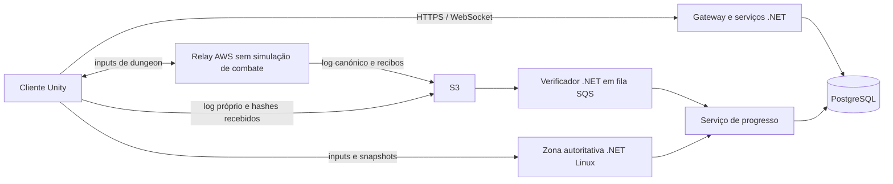

# Arquitetura de rede do AnimLab como MMO

**Estado:** proposta para decisão; sem implementação. **Data:** 31 de outubro de 2026. **Projeto:** `C:\Users\Martim\AnimLab`, Unity 6000.3.15f1 / URP. Documento em português; exemplos de texto apresentado ao jogador em inglês.

## 1. Decisão proposta e limites da evidência

Adotar um núcleo de regras C# partilhado por três executores: **mundo autoritativo .NET/Linux**, **dungeon cooperativa em rollback entre 2–5 clientes através de relay AWS**, e **verificador .NET que reproduz a dungeon antes de autorizar progresso**. O servidor continua a ser o único autor de personagens, inventário, moeda, XP e loot em ambos os modelos.

**A fase 6 do plano anterior, Steam P2P, está cancelada para esta arquitetura.** Os documentos `Netcode_Rollback.md` e `Netcode_Progress.md` permanecem como histórico do banco de combate. Este documento substitui a sua direção de produto; não os altera. Nenhum trabalho Steam é necessário para executar as fases abaixo.

Três limites condicionam a decisão:

- Um replay válido prova que uma sequência admitida de inputs produz um resultado permitido pelas regras. Não prova que houve input humano, ausência de automação, ausência de informação extra ou ausência de conluio entre todos os membros.
- Verificar 100% dos ticks depois da partida executa aproximadamente o mesmo trabalho de simulação que executá-los durante a partida. As poupanças possíveis vêm de processamento em lote/Spot, menor obrigação de latência e menor replicação; não de multiplicar a velocidade de replay.
- Segundo as fontes AWS consultadas, desde 15/06/2026 o tráfego de instâncias GameLift Servers elegíveis de geração 6 ou superior está incluído. Isso muda a comparação: relay EC2 com tráfego pago pode custar mais do que dungeons autoritativas em GameLift. Preservar a opção híbrida pedida, mas exigir a comparação económica da §9 antes de a tornar compromisso de produção. [S1][S2]

### 1.1 O que foi observado no projeto

| Evidência lida | Consequência para o plano |
|---|---|
| `Docs/Biblia.md`: sete elementos, estados, Avatar State, Bankai e Domain Expansion; o texto distingue visão e implementação | Os três poderes simultâneos precisam de estados de combate; Domain Expansion 1v1 dentro do MMO não transforma o jogo num produto de duelos |
| `Sim/World.cs`, `State.cs`, `CombatRules.cs`: 60 Hz, `P0..P7`, `Count`, equipas, alvo e `StruckMask`; chão y=0, raio 20, cinco estilos | Já suporta até oito lutadores de simulação, mas não entidades arbitrárias nem mais de dois peers de rede |
| `PlayerInput.WireSize=11`; `StateCodec.Version=6`; Q32.32; `Fix` usa intermediários de 128 bits em `ulong`, sem `BigInteger` no caminho aritmético | Contratos já evoluíram; preservar compatibilidade por versão e medir o conteúdo MMO nas plataformas alvo |
| `RollbackSession`: 128 estados, máximo 8 ticks, dois streams; checksums confirmados de 30 em 30 ticks | Reutilizar o algoritmo; generalizar armazenamento, confirmação e identidade; não aumentar apenas um tamanho de array |
| `MatchHandshake`: cada cliente propõe stats dentro de intervalos | Válido para laboratório; inadmissível como origem dos stats de um MMO |
| `Sim/DuelistBrain.cs` já porta a IA; `Sim/Abilities.cs` simula Dash/Bola de Fogo, mana, cooldowns, projéteis e duração/resistência dos estados; restantes habilidades ainda dependem dos scripts Unity | Reaproveitar o porte existente e completar regras/conteúdo; não voltar a começar a IA e as duas habilidades do zero |
| `Combatant` mantém estados, duração e resistências; `CharacterStats` e a hotbar usam `PlayerPrefs` | Estado persistente e validação das escolhas passam para o backend; o cliente apresenta uma cópia |
| Fogo e água chamam efetivamente `Combat.Explode`/`TakeHit`; vários outros efeitos são sobretudo visuais/física de objetos | Não assumir que a aparência de Lightning/Kirin/Thunder/tornados já define dano e regras completas |

O relatório anterior regista 39/39 testes na fase 5, 54/54 na fase Steam e 60/60 na atualização parcial da fase 7, além de convergência Mono/CoreCLR e entre dois processos Windows nos cenários descritos. São **resultados históricos**, não testes executados para este plano, nem prova de Linux ARM64, IL2CPP, cinco peers, bosses, segurança ou capacidade MMO. A validação em dois PCs físicos continua indicada como pendente.

Na execução anterior foram observadas alterações locais por gravar. Na retoma de 31/10/2026, o Git estava limpo e a leitura confirmou código mais recente em Sim/IA/habilidades e o registo parcial da fase 7. A §10 usa este inventário atualizado, incluindo Steam e `DatagramSession.cs`; as escritas desta tarefa limitaram-se a este documento. Houve evolução concorrente de ficheiros Steam/UI durante a leitura, pelo que o inventário descreve responsabilidades e não uma revisão atómica do código.

### 1.2 Proposta versus validação

Todos os limites de jogadores, tempos de CPU, taxas de tráfego e capacidades por máquina abaixo são **orçamentos para testar**, não medições deste projeto. As decisões recomendadas estão identificadas; as alternativas que mudam o produto/custo estão na §12. Não foi compilado, iniciado, testado ou publicado qualquer servidor nesta tarefa.

## 2. Fronteiras de autoridade

| Conteúdo | Executor do combate | Autoridade persistente | Limite inicial proposto |
|---|---|---|---|
| Mundo aberto e PvE público | Um processo de zona .NET | Backend + zona com lease válida | 100 jogadores por zona; §4.5 |
| Cidades | Zona .NET; IA reduzida onde não há combate | Backend | 150 jogadores, inicialmente 100 |
| PvP aberto, bosses públicos, conflitos entre grupos | Zona .NET | Zona e backend | Sem P2P, incluindo prémios de PvP |
| Dungeons cooperativas privadas | Todos os clientes simulam o mesmo estado via rollback | Backend, após verificação | Roster inicial de 2–5; até 32 mobs ativos |
| Dungeon competitiva, ranking com prémios, invasão de outro grupo | Recomendação: instância autoritativa | Backend | Fora do MVP P2P |
| Domain Expansion com adversário do mundo | Subinstância/arena autoritativa reservada pela zona | Backend | 2 participantes; preservar cooldowns e posse |
| Treino local/duelo de laboratório | Banco atual offline/rollback | Sem progresso MMO | Conservar para regressão |

Avatar State e Bankai são modificadores sobre a mesma entidade e o mesmo estado, acumuláveis segundo a Bíblia. Não criam cópias persistentes da personagem. A entrada num Domain exige regras de consentimento/CC e de saída; nunca pode servir para desligar PvP ou retirar um inimigo para um cliente autoritativo.



O gateway não retransmite todos os datagramas de combate. Autentica, reserva e fornece endpoints/tokens. O cliente liga diretamente ao processo de zona ou ao relay atribuído. A apresentação nunca envia `SetHealth`, `GiveItem` ou um snapshot a substituir a personagem do backend.

## 3. Estado da personagem, handoff e recuperação

### 3.1 Contratos de estado

Separar três categorias, com IDs estáveis e versões explícitas:

- **Persistente:** `AccountId`, `CharacterId`, nível/XP inteiros, atributos base/pontos, `TreeA/TreeB`, nós aprendidos, `StyleId`, hotbar de 9 `AbilityId`, equipamento, instâncias de itens com GUID/quantidade, moedas, quests e flags de progresso. A configuração de teclas e gráficos continua local. Não usar `displayName` como chave de habilidade.
- **Estado vivo autoritativo:** zona/canal, posição válida, HP/mana/postura, cooldowns, estados com expiração, ataque/cast em curso, relógios por corpo e efeitos de Avatar/Bankai. Stats derivados são calculados no servidor a partir das definições versionadas.
- **Estado exclusivo de execução:** inputs, snapshots de previsão/rollback, IA, RNG, projéteis e eventos. Não equivale a um save de inventário.

Contrato de entrada conceptual:

```text
RunManifest {
  runId, nonce, region, dungeonId, difficulty, roster[2..5], peerSlots,
  protocolVersion, inputSchemaVersion, simBuildHash, rulesHash, mapCollisionHash,
  initialStateHash, initialStateLocation, characterEntryVersions[], configRevision,
  gameplaySeed, lootSeedCommitment, escrowIds[], returnLocations[],
  tickRate=60, inputDelay, maxRollback=8, disconnectPolicyVersion,
  notBefore, startDeadline, maxSimulationTicks, maxWallDuration, relayAssignmentEpoch,
  signingKeyId, serverSignature
}
```

O estado inicial contém vitais/cooldowns/status válidos e a configuração calculada pelo servidor. A semente de gameplay é partilhada; a de loot fica secreta no backend. Uma assinatura do manifesto abrange a serialização binária canónica integral, incluindo hashes de conteúdo e política de abandono.

### 3.2 Fluxo mundo → dungeon

1. O líder pede entrada; cada membro confirma prontidão. O serviço valida conta, personagem, party, região, versão de build, acesso, lotação e latência até ao relay. Não basta o líder enviar a ficha dos outros.
2. A zona exige portal/safe point e ausência de combate nos últimos **10 s**. Reservar capacidade e criar `runId` idempotente. Uma personagem não pode estar em duas reservas ativas.
3. O backend reserva/coloca em escrow os itens autorizados, custos de entrada e loadout. A zona corta os inputs num tick definido, grava o estado de saída e emite um recibo interno. A personagem só deixa de existir no mundo quando essa posse estiver transferida duravelmente.
4. Máquina de estados persistente: `WorldResident → Reserved → Detached → InstanceActive`. Cada transição verifica versão e `ownerEpoch`. Se a reserva falha antes de `Detached`, continua no mundo. Depois disso, só o coordenador pode recuperar a posse.
5. Backend gera manifesto assinado e tokens separados por conta/peer/run. Os clientes carregam os mesmos dados e confirmam hashes. Deadline de preparação: **60 s**; sem todos prontos, cancelar e devolver a posse/escrow por transação idempotente.
6. O relay publica `Start` assinado, tick zero e âncora de tempo, depois de confirmar a posse. Só então começa o combate. O primeiro cliente não é host de regras, RNG, loot ou seleção de estado inicial.

Manter `CharacterOwner(characterId, locationKind, locationId, ownerEpoch)` no backend. Heartbeats pertencem ao processo/lease da zona ou run, não a uma escrita por personagem a cada tick. Uma lease expirada não autoriza dois servidores a aceitar comandos: a nova época invalida gravações da antiga. Reservas e handoffs são sagas com compensação, não uma transação de base de dados aberta durante o carregamento do Unity.

### 3.3 Regresso e recompensas

`InstanceActive → VerificationPending → RewardCommitted/Rejected → Closed`; a localização do jogador pode entretanto voltar ao mundo através de um handoff próprio. `runId` e `RewardId` impedem que um segundo pedido ou uma reconexão repita o pagamento.

- O cliente apresenta `Verifying rewards...` e pode regressar a um portal seguro. Não se publica loot/XP como disponível enquanto a verificação não terminar.
- Durante a pendência, a personagem pode jogar no mundo, mas não iniciar outra dungeon; os itens em escrow não podem ser vendidos, equipados noutro contexto ou consumidos novamente. O retorno usa vitais/cooldowns definidos pelo backend a partir do estado de entrada e da regra de regresso, nunca o HP que o cliente declara. Recomendação inicial: sem cura gratuita e sem encurtar cooldowns de entrada.
- Após replay válido, aplicar **deltas calculados pelo verificador**, consumo de escrow e direitos de recompensa numa transação PostgreSQL. Não substituir a ficha atual por uma ficha antiga do fim da dungeon. A transação cria outbox para a zona atualizar XP/configuração num ponto seguro.
- Loot usa regras e semente do backend: por exemplo, compromisso `SHA256(lootSeed || runId || lootTableVersion)` no manifesto, e sorteio após validar a conclusão. Repetir o pedido mantém os mesmos resultados. O cliente não escolhe seed nem pode tentar várias finalizações para mudar o prémio.
- Inventário cheio: guardar o prémio em caixa de entregas persistente. Falha de gateway/DB após validar: repetir a transação; não repetir o sorteio.

### 3.4 Desconexões e saídas

| Caso | Política proposta |
|---|---|
| Queda no mundo | Controlos neutros; avatar continua vulnerável **15 s** em combate. Reconexão com token novo, snapshot da zona e mesma posse; sair não evita uma morte já decidida |
| Zona cai | Recuperar checkpoint da zona + journal de eventos económicos; RPO de posição/vitais inicialmente até **5 s**. Itens/moedas confirmados têm RPO zero por transação. Teleportar para ponto seguro se não houver recuperação válida |
| Um peer de dungeon deixa de fornecer inputs | Rollback só prevê até ao limite; pode haver stall. Após **1 s** sem stream utilizável, o relay sela as lacunas e emite `PeerSuspended` com tick efetivo. Todos usam a mesma regra neutra; não há invulnerabilidade por desconexão |
| Peer volta | Janela de **60 s**; reentrada apenas do mesmo membro, preferencialmente num checkpoint seguro. Snapshot de recuperação validado por replay do servidor, não eleito por maioria dos clientes |
| Saída voluntária | Evento `Leave` canónico, fim definitivo dos inputs desse slot; sem novos jogadores a substituir membros no MVP. Restantes continuam mesmo se ficarem só um; a dificuldade não baixa no meio de um boss |
| Quem sai a meio | Mantém apenas direitos dos checkpoints já concluídos e verificados; sem loot final de boss posterior à saída. Regras de contribuição/AFK entram no manifesto e replay; interrupção breve dentro da janela não cancela automaticamente os direitos |
| Todos saem / relay indisponível | Fechar ou suspender; sem simulação offline elegível para progresso. Recompensas parciais só de prefixos totalmente verificáveis |
| Relay cai | Lease/época nova; retomar apenas o prefixo com recibos e dados recuperáveis. Sem prefixo verificável: abortar, devolver posse e aplicar política de escrow; nunca aceitar um estado final por consenso |

O relay sela um input uma única vez. Para preencher lacunas, a política versionada permite repetir apenas os botões contínuos por até **6 ticks**, sem flancos, e depois input neutro com guarda/cast libertados. O tick inicial em falta e os preenchimentos são assinados; inputs tardios que tentem alterar um intervalo selado são rejeitados. O stall não deve exceder 8 ticks de previsão: pode parar o grupo durante a decisão de suspensão, não continuar a simular indefinidamente. Pausas técnicas têm âncoras `Pause/Resume` assinadas e orçamento total de **60 s** por run, distinto dos 60 s de reentrada.

Não existe migração de host de gameplay: todos os peers executam a simulação. A continuidade depende do relay/coordenador e do log, não do líder da party. Recuperar uma run de 30 minutos por replay pode levar dezenas de segundos; mostrar `Rejoining...`, sem prometer reconexão instantânea.

## 4. Servidor autoritativo do mundo

### 4.1 Processo e tick

Um processo .NET/Linux é dono de cada `(Region, Shard, Zone, Channel, Epoch)`. A recomendação para código novo é **.NET 10 LTS**, conservando o subconjunto C# compatível com Unity no núcleo partilhado; o verificador histórico aponta para .NET 8, cujo suporte está próximo do fim na data deste documento. Não basta alterar o framework para provar compatibilidade. [S3]

- **Simulação de movimento/combate: 60 Hz**, 16,67 ms/tick. IA toma decisões a 10 Hz e produz intenções aplicadas nos ticks de 60 Hz. Não baixar todo o combate para 10/20 Hz para acomodar mais população.
- **Snapshots de rede: 20 Hz** para entidades relevantes em combate; outros níveis na §4.5. Inputs amostrados a 60 Hz, enviados a 30 datagramas/s com vários samples e recuperação seletiva de lacunas.
- Objetivo por zona ocupada: CPU/tick p95 ≤ **8 ms**, p99 ≤ **12 ms**, incluindo simulação, geração de deltas e consultas históricas; watchdog antes de ultrapassar 16,67 ms sustentadamente. I/O e persistência ficam fora do loop de simulação.
- Estado e geração de eventos têm um escritor por zona. Processar entidades e candidatos de contacto por IDs estáveis; paralelizar zonas e jobs independentes antes de introduzir concorrência dentro do resultado de um tick.
- O servidor recebe intenções; valida velocidade, recursos, equipamento, habilidade aprendida, cooldown, alcance e sequência. Configurações de cliente, relógio local e resultados de física Unity não têm autoridade.
- Sem `Time.timeScale` global: hit-stop afeta os corpos envolvidos segundo regras; o resto da zona continua. Slow-motion, faíscas, nevoeiro e câmera são apresentação local. O atual `Stop` congela todos os lutadores e os projéteis da sessão; limitar o efeito aos participantes no mundo exige uma alteração explícita de regras, preservando o comportamento da dungeon até decisão de design.

### 4.2 Previsão local e reconciliação

Prever **só a entidade controlada pelo jogador**: movimento, guarda, roll, fase da arma e custo visual de cast. Não prever resultados finais sobre inimigos, drops ou colisões de todos os jogadores como numa dungeon.

```text
ClientInputBatch: sessionEpoch, firstInputSeq, samples[], lastSnapshotAck
WorldSnapshot: zoneEpoch, serverTick, baselineId,
  lastProcessedInputSeq, inputExecutionTick,
  localAuthoritativeState, entityDeltas[], confirmedEvents[]
```

Guardar **256 ticks** de inputs/estados locais. Ao receber um snapshot: restaurar o estado local autoritativo, descartar inputs reconhecidos e reproduzir apenas os ainda pendentes. O ack inclui a correspondência entre sequência local e tick realmente executado pelo servidor; não assumir que os dois relógios começaram no mesmo tick. Reutilizar as regras e o princípio de restauro do rollback, com um controlador de previsão próprio para o mundo.

Na física predita, os outros corpos são proxies de snapshots, sem controlar o seu HP/IA. Empurrões entre jogadores e knockback recebido são corrigidos pelo servidor. Recomenda-se colisão suave entre aliados e ausência de body-block nas cidades, como decisão de design a confirmar; não substituir a colisão de combate sem aprovação.

O estado lógico corrige imediatamente. A malha/câmara pode suavizar erro de posição < **0,25 m** em **80–120 ms**; erro > **1 m**, teleporte, troca de zona ou estado inválido faz snap. Valores intermédios ajustam-se no protótipo. Não suavizar o collider lógico até uma posição falsa. Se o histórico de 256 ticks expirar, pedir estado completo e recomeçar a previsão.

Um input recebe no máximo uma execução; o servidor não avança mais ticks porque um cliente envia mais pacotes. Input ausente repete apenas estado contínuo por **3 ticks**, depois neutraliza; flancos de ataque/cast não são inventados. Ack de comandos e orçamento de fila impedem acumular ataques antigos para os executar num burst.

### 4.3 Interpolação e compensação de latência

As outras entidades interpolam snapshots com atraso inicial de **50 ms**, adaptável a **100 ms** se houver jitter. Extrapolar movimento até **100 ms** sem inventar ataques; depois congelar/sinalizar perda de ligação. Entradas/saídas de AOI incluem baseline completa e geração do ID para não reutilizar uma entidade antiga por engano.

Para golpes melee, manter **250 ms de histórico** de cápsulas, yaw, segmentos de lâmina, flags de movimento e bloqueadores relevantes. É histórico de consulta, não um rollback global da zona. Ataques ativos são produzidos pelo servidor, nunca pela declaração `I hit entity X` do cliente.

Política inicial, deliberadamente conservadora:

1. Gerar o varrimento da lâmina validada no tick de resolução `T`. Cada ataque tem `AttackInstanceId` e conjunto de alvos já atingidos, generalizando a atual `StruckMask` de slots fixos para IDs de entidades.
2. Para corrigir a posição remota vista pelo atacante, consultar a cápsula da vítima em `T - L`, com `L = min(100 ms, RTT_base/2 + 50 ms)`. `RTT_base` usa amostras robustas da ligação, não um timestamp escolhido pelo cliente nem o pico de um lag switch. Limitar também a diferença de posição histórica a **0,5 m**; reduzir L quando ultrapassar esse deslocamento.
3. A lâmina é a do ataque autoritativo atual; a consulta da cápsula histórica é uma concessão espacial assimétrica explícita. Não equivale a reconstruir duas realidades perfeitamente simultâneas. Guardas, invulnerabilidade, morte e recursos usam o estado **atual da resolução**. Favorece defesa atual e evita anular uma defesa já aceite.
4. Validar linha de contacto/bloqueadores atuais e históricos para não confirmar um golpe através de uma porta fechada/parede. Guardar histórico de portas se forem móveis. Não aumentar livremente hitboxes para compensar latência.
5. Projéteis já em voo, DoT e áreas persistentes usam a simulação atual. Não aplicar novamente rewind a cada tick de um projétil nem ao dano de uma área inteira.

Começar o protótipo com **L=0** como controlo e comparar com esta política. O limite de 100 ms não é promessa de igualdade a 200–300 ms RTT; há ataques que irão falhar na imagem do atacante ou aparentar acertar tarde na da vítima. O princípio de histórico, previsão/reconciliação e os seus compromissos têm documentação pública de motores; os números acima são proposta do AnimLab. [S4][S5]

### 4.4 Parry, guarda e clash: proposta concreta para 0,2 s

**Escolha recomendada para a primeira versão do mundo:** autoridade do servidor com início da guarda no tick em que o input é executado, sem guarda retroativa e sem reabrir um resultado final. Resposta visual local imediata; resultado de parry, dano, stagger e clash só confirmado pelo servidor. É implementável e auditável, mas menos fiel ao timing local do que o rollback de uma party pequena.

Precisão das regras atuais: a janela de **parry** é 0,2 s de `BodyTime`; Fencer acrescenta 0,08 s. Guarda mantida não tem duração de 0,2 s. Clash é contacto entre lâminas ativas, não uma janela genérica de parry. Manter estas distinções e o lockout de **0,35 s**; mudar estes números seria balanceamento separado.

| Regra | Mundo autoritativo proposto |
|---|---|
| Janela base | Aproximadamente 12 ticks a 60 Hz; preservar a comparação inclusiva da fronteira atual e testar 11/12/13 ticks, em vez de introduzir um tick extra inadvertidamente |
| Tolerância temporal | Só quantização/agendamento de até um tick; **não** somar RTT à janela nem aceitar um `GuardStartedAt` arbitrário do cliente |
| Ordem do tick | Aplicar inputs admitidos, atualizar estados, gerar contactos; resolver candidatos com ordenação canónica. Guardar testes da prioridade atual de clash entre lâminas e parry no contacto corporal |
| Guarda frontal | Arco atual de ±75° e orientação autoritativa no tick de resolução; defesa atual pode vencer uma consulta espacial histórica |
| Clash | Duas lâminas realmente ativas no mesmo tick autoritativo, com subpassos; sem cruzar uma lâmina presente com outra de 100 ms atrás para criar clash |
| Resultado | Um único evento confirmado com `zoneEpoch/tick/AttackInstanceId/targetId/eventOrdinal`; HP, recoil, postura e interrupção vêm desse resultado |
| Hit-stop | Congela só os participantes; `BodyTime` é guardado. A janela pode durar mais de 0,2 s de relógio global durante a paragem, conforme a regra atual |

**Exemplo de RTT 80 ms:** carregar guarda mostra a pose imediatamente. O input pode iniciar a guarda no servidor cerca de **40–57 ms** depois. A resposta de confirmação pode chegar cerca de **80–107 ms** depois, antes de efeitos adicionais de jitter. Um ataque resolvido antes dessa execução não passa a parry por ter parecido defensável localmente. O snapshot devolve início/estado reais; a previsão local reconcilia.

Para reagir a um ataque remoto, o custo aproximado é `uma via atacante→servidor + servidor→defensor + interpolação + reação humana + defensor→servidor`. Com dois RTT de 80 ms, 50 ms de interpolação e reação de 150 ms, são cerca de **320 ms** desde a ação original do atacante. A janela de parry de 200 ms não elimina esse percurso. As adagas atuais têm windup de 60 ms: não se pode prometer parry reativo ao início desse golpe, mesmo com rede muito boa. Também não se deve confundir essa latência de informação com duração da guarda.

Para bosses e golpes que o design pretende que sejam reagíveis, propor telegraphs de **350–500 ms**, enviados como eventos prioritários de início com tick, sem esperar pelo próximo snapshot; executar a fase visual a partir do tick recebido. Para PvP, escolher conscientemente entre leitura/antecipação e alongar telegraphs de determinados ataques. Isso precisa de aprovação de design, não fica disfarçado no netcode.

| RTT até à região | Expectativa e admissão inicial |
|---|---|
| ≤80 ms, jitter p95 ≤20 ms | Alvo para combate de precisão; medir confirmações e parries rejeitados na fronteira |
| 80–150 ms | Jogável com antecipação; mais correções. Mostrar indicador de qualidade |
| 150–250 ms | Sem garantia de parry reativo; recomendar outra região/canal. Não alargar silenciosamente a janela |
| >250 ms ou jitter/perda persistente | Não admitir em atividade competitiva de precisão; permitir social/PvE adequado se o produto o aceitar |

O jogador vê guarda/roll e início de ataque preditos imediatamente. Faísca leve de contacto pode ser provisória; `PARRY`, `CLASH`, dano numérico final, recompensa e stagger forte esperam confirmação. Em correção, ajustar pose/vida e cancelar o efeito provisório possível; não é possível apagar um som já ouvido. Evitar o slow-motion global atual num espaço com espectadores.

**Alternativa em aberto, fora da primeira versão:** manter contactos pendentes 50–100 ms para admitir defesa atrasada ou usar rollback de uma ilha de combate. Isso adiciona atraso de dano/CC, exige invalidar ataques dependentes e pode juntar ilhas até abranger uma zona inteira. Não é apenas aumentar a janela. Só escolher após comparar duas gravações sincronizadas sob latência; não prometer simultaneamente resposta final imediata, igualdade perfeita e autoridade sem esse custo.

Referências de jogos reais, com separação entre factos e inferências:

| Jogo / fonte primária | O que a fonte permite afirmar | Aplicação proposta ao AnimLab |
|---|---|---|
| New World, deep dive de 16/02/2024 [S6] | Reformulou execução de combate/animações por custo de CPU, memória e escalabilidade em áreas com jogadores | Inferência: medir o caminho completo de cada personagem e evitar alocações; não há na fonte garantia de uma tolerância de parry específica |
| Throne and Liberty, Update 4.12.0 [S7] | Documenta o stun de Iron Point Parry contra Fury Attack dentro de 0,5 s | Demonstra uma janela específica de habilidade mais larga que 0,2 s; não prova uma implementação de rollback ou a regra de compensação do AnimLab |
| Lost Ark Academy, counterattacks [S8] | Descreve counters, posicionamento frontal e telegraphs mais claros para alguns ataques futuros | Inferência: legibilidade e antecipação podem tornar o combate de boss viável sem fingir que a rede não existe |
| Black Desert, notas de 19/03/2026 [S9] | Corrige aplicação/duração de Forward Guard e Super Armor em habilidades concretas | As flags e transições exatas importam; a fonte não revela tick rate ou protocolo interno. Não copiar uma alegada arquitetura de relatos de jogadores |

Não há evidência primária aqui de que algum destes jogos garanta uma janela universal de 200 ms igualmente justa para todos os pings. Não usar testemunhos sobre desync para inventar essa garantia.

### 4.5 AOI, zonas, shards e canais

- **Shard:** população/economia persistente; **zona:** unidade de autoridade/simulação; **canal:** cópia da zona dentro do shard. Party/chat podem atravessar canais. A economia não precisa de ser duplicada por canal.
- Começar com transições explícitas entre zonas. Handoff reserva destino, corta origem num tick e transfere posse por época. Sem combate através de uma fronteira que está em migração; fronteiras em portais/áreas neutras. Mundo sem costuras e simulação distribuída de um mesmo combate são outro projeto.
- AOI por grelha espacial de **32 m**, raio inicial de **80 m**, saída a **96 m** para histerese; acrescentar dependências de projéteis/áreas, alvo, party e telegraphs. Distância vertical e instância também filtram. AOI de rede não pode omitir uma ameaça que ainda causa dano.
- Perfil típico: até **24 entidades próximas a 20 Hz**, mais **40 distantes a 5 Hz**; alterações importantes de combate são eventos prioritários. NPCs decorativos a 1–2 Hz ou locais sem gameplay. Não parar a simulação autoritativa de uma ameaça porque saiu do ecrã.
- Começar com **100 jogadores por zona de mundo**, máximo de **200 mobs ativos**, e cidade sem combate até **150** após medição. Usar limite suave de admissão de 80; abrir canal quando necessário e manter a party junta.
- Um combate muito concentrado pode exigir replicar 64+ corpos a frequência alta. O orçamento sobe e o servidor pode falhar antes do limite global. Não esconder jogadores que continuam a atacar. Ensaiar 32/64/100 combatentes no mesmo local; se falhar, limitar/adaptar esse conteúdo e capacidade de área antes de vender PvP massivo.
- Não prometer cercos de 500 jogadores. Alterar o máximo por zona só com carga real de movimento, colisões, IA, ataques e áreas, e com cliente a renderizar a multidão.

Orçamento típico de download: `24 × 20 × 16 B + 40 × 5 × 12 B ≈ 10,1 kB/s` de deltas, mais cerca de 2 kB/s para cabeçalhos, eventos e correções: **12 kB/s por jogador**, ≈96 kbit/s. Records de 12–16 B são médias de deltas quantizados contra baselines, não snapshots completos do estado atual. Definir posição por célula/centímetros, yaw quantizado e campos de combate enviados quando mudam; validar overflow e teleporte.

Orçamentar **4 kB/s de upload**, **32 kB/s de download sustentado em área densa**, burst de **64 kB/s** durante baseline/entrada. Particionar baselines, payload de aplicação ≤**1 000 B** e envelope UDP total ≤**1 200 B**, sem depender de fragmentação IP. Monitorizar média, p95 e percentagem de tempo em cada perfil. O custo da §9 usa 12 kB/s médio, e aumenta se a população permanecer concentrada.

## 5. Dungeons determinísticas para 2–5 jogadores

### 5.1 Tudo o que altera o resultado entra em Sim

Uma dungeon não pode ter mobs/skills a correr em MonoBehaviours enquanto só os jogadores fazem rollback. A re-simulação tem de reproduzir **todos os agentes e todas as regras que influenciam vitória, consumo ou recompensa**.

Estado conceptual, sem impor já uma implementação ECS:

```text
DungeonState {
  tick, contentRevision, worldRng,
  entities[] ordenadas por EntityId/Generation,
  movement[], combat[], resources[], statusSlots[], castStates[],
  aiStates[], threatTables[], projectiles[], areas[], mapDynamicState[],
  attackHitSets[], scheduledEvents[], encounterPhase, objectiveFlags,
  participationFlags[], consumptionLedger[], spawnCounters
}
```

Separar definições imutáveis do estado mutável. IDs não dependem da ordem de instanciação no Unity. Criar/destruir entidades em fronteiras de tick, com contador de spawn no snapshot e IDs não reciclados durante a run. Não basta copiar uma struct que contenha arrays partilhados: snapshots precisam de cópia profunda/páginas com posse clara e buffers pré-alocados.

Portas, plataformas, chão, alturas, inclinações e obstáculos precisam de colisão determinística exportada/versionada. Para o primeiro protótipo, sala plana com cápsulas e caixas; para o MMO, grelha de alturas e colisores estáticos simples por célula. O hash do mapa cobre a geometria de gameplay, água e navegação. Não usar PhysX/NavMeshAgent como oráculo de uma simulação que se pretende reproduzir em .NET puro.

### 5.2 Mobs e bosses

Reaproveitar o porte já existente em `Sim/DuelistBrain.cs`, com RNG e memória em `AiState`, e adaptá-lo a mobs/bosses e IDs arbitrários. Não executar `DuelistAI.cs` como MonoBehaviour no servidor nem gravar só o seu resultado como input confiável.

- Estado da IA inclui alvo, aggro, ameaça por peer, próxima decisão, tempos de reação, combo pendente, direção de strafe, fase e cooldowns de boss.
- Decisões a **10 Hz**; movimento/armas/hitboxes a 60 Hz. Converter os intervalos atuais de 0,15–0,4 s para ticks inteiros e guardar os agendamentos no snapshot.
- Substituir `UnityEngine.Random`, `Time.time`, `Mathf.PerlinNoise`, `Transform` e consultas de componentes por RNG explícito, ticks, ruído determinístico/tabelas e `EntityId`.
- RNG por entidade/encounter e stream, derivado da seed e spawn ID, para que uma faísca visual ou um mob morto não altere todos os críticos seguintes. Estado de cada stream no snapshot. Não usar o RNG da apresentação para gameplay.
- Navegação inicial por waypoints/grelha com desempate por ID; A* com limite fixo de trabalho e fila/resultado no snapshot, se necessário. Não decidir um caminho diferente só porque o frame de um cliente demorou mais.
- Bosses: FSM/árvore de comportamento com dados versionados, seleções e telegraphs determinísticos, sem consultar o relógio real. Mudanças de fase, invocações e objetivos são eventos de Sim.

### 5.3 Habilidades e estados

| Origem atual | Regra a portar / decidir | O que fica no Unity |
|---|---|---|
| `Ability.cs`, `AbilityBar.cs` | `AbilityId`, autorização pela árvore/loadout, mana, regeneração, cooldown, cast, canalização, interrupção e flancos de input | HUD, ícones, drag/drop e pedido de ação |
| `DashAbility.cs` e `Sim/Abilities.cs` | Reaproveitar trajetória/custo/cooldown já portados; completar colisão de mapa e validar paridade; não é o mesmo movimento que Roll | Rasto, água, nevoeiro e pose |
| `WaterBallAbility.cs`, `WaterBallProjectile.cs`, `WaterGather.cs` | Volume/carga, custo por fração, disponibilidade de água, compressão, soltar, mira, voo, impacto e Wet | Gotas, malha, tremor e fusão visual; o instante de absorção de gameplay deve ter regra fixa |
| `FireBallAbility.cs`, `FireBallProjectile.cs` e `Sim/Abilities.cs` | Reaproveitar formação, trajetória, explosão, defesa mágica e aplicação de Burning; completar efeitos periódicos, equipas e alvos por ID | `FireBallEffect`, `FireBallFlightVisual` e partículas |
| `WindBallAbility.cs`, `WindBallProjectile.cs` | Canalização/compressão, trajetória, impacto e impulso em entidades de gameplay | Vórtice e detritos; `Rigidbody.AddForce` atual não define knockback de uma personagem de rede |
| `LightningAbility.cs`, `LightningDischarge.cs`, `LightningWaterGrid.cs` | Alcance, conectividade de água, propagação, escolha de alvos e Wet/Static; definir o dano que não está completamente implementado como regra atual | Ramificações decorativas, glow e desenhos dos raios |
| `KirinAbility.cs`, `KirinEffect.cs`, `ThunderAbility.cs` | Tempo de cast/impacto, alcance, alvos, dano e propagação em dados; não deduzir dano da chegada de uma malha | Dragão, geometria, luz e impacto |
| `SummonAbility.cs`, tornados | Duração, área, periodicidade de dano/CC e ownership se passarem a afetar combate | Instanciar template só para desenhar o efeito |
| `Combat.cs`, `Combatant.cs` | Tipos, defesa física/mágica, resistências, refresh/stacking, dano periódico, poise, invulnerabilidade e knockback | Callouts, cores, nameplates e reações visuais |

No código lido, os estados têm armazenamento, expiração e resistências, mas isso **não prova a aplicação de todos os efeitos descritos na Bíblia**. Por exemplo, não assumir que o Burning já retira 1% por segundo ou que Asphyxia já trava a mana só porque existe o enum. A migração exige testes de regra explícitos:

- Wet/Frozen: multiplicador de velocidade **0,75**, sem transformar Frozen em imobilização que a Bíblia não pede.
- Static: ensaio de probabilidade **10% a cada 60 ticks ativos**, RNG de gameplay e instante do próximo ensaio no snapshot; decidir duração do stagger.
- Grounded: impedir salto + Slow; percentagem de Slow ainda por decidir.
- Asphyxia: bloquear regeneração/receção de mana segundo regra a fechar, incluindo canais e consumíveis.
- Burning: **1% da vida máxima por segundo**, com acumulador inteiro/fixo e periodicidade definida; confirmar se ignora defesa e se é letal.
- Blind: flag autoritativa com efeito visual local; um cliente modificado pode remover a cegueira visual. Replay não demonstra que o jogador não via.

Usar slots/arrays ordenados para os sete estados, com origem, duração, expiração e acumuladores; definir refresh sem stacking como comportamento inicial onde coincide com `ApplyStatus`. Arrays por índice substituem iteração de dicionários de resistências. Distinguir relógio global de cooldown/status e `BodyTime` de animação/hit-stop; escolher e testar quais expirações congelam. A regra fica no hash de conteúdo.

A água que conduz eletricidade ou acelera a carga tem uma máscara/grelha determinística. `WaterSim`, `WetSurface` e shaders podem desenhar deformações diferentes sem alterar o combate; qualquer deformação que altere a regra tem de ser representada em Sim. Não transmitir milhares de gotas nem re-simular malhas/shaders no verificador.

### 5.4 Sessão de N peers

Generalizar a sessão, mantendo uma única simulação partilhada por todos:

1. Roster fixo de 2–5 `PeerId`; `EntityId` do avatar é distinto do slot de rede. Mobs não são peers.
2. `InputHistory[peer, tick]`, `UsedInput[peer, tick]` e watermark contíguo por peer. `ConfirmedTick = min(watermarks de todos os streams obrigatórios + 1, simulatedTick)`; saídas/substituições neutras entram no próprio stream canónico.
3. Prever cada stream em falta repetindo contínuos e limpando flancos. Ao chegar uma diferença, restaurar o **primeiro tick sujo de qualquer peer** e re-simular uma vez até ao presente, não fazer um replay separado para cada pacote.
4. Buffer de **128 snapshots** e profundidade máxima de **8 ticks = 133,3 ms**. Manter atraso inicial de **2 ticks**; selecionar 2–4 na entrada conforme RTT/jitter. Delay só muda num checkpoint com evento comum, não independentemente em cada PC.
5. Não avançar mais de 8 ticks previstos para além do stream mais atrasado. O peer lento pode causar stall em todos; grupos de cinco agravam a probabilidade. Se isso for frequente, reduzir escopo de conteúdo/grupos ou passar essa instância para autoritativa.
6. Pacing segue o relógio/âncoras do relay e a vantagem de frame do grupo, não a opinião de um host. Checksums rápidos a cada **30 ticks confirmados**; SHA-256 de estado canónico em fronteiras de **60 ticks** para o protocolo de verificação.
7. `EventId = (runEpoch, tick, sourceEntityId, actionInstanceId, targetEntityId, ordinal)`. O atual packing com shifts de 4 bits colide com IDs de mobs e múltiplos eventos iguais no mesmo tick. Suportar cancelamento de efeitos provisórios e deduplicação após replay.

Aproximação de idade do input remoto: `ceil(60 × (RTT_A/2 + RTT_B/2 + jitter) / 1000) - inputDelay`. Cada RTT é cliente↔relay; não confundir com RTT entre peers. Dois membros com RTT 80 ms até ao relay dão cerca de 80 ms de caminho A→relay→B antes de jitter: aproximadamente cinco ticks, reduzidos pelo delay local. Objetivo de matchmaking: todos com RTT p95 até **100 ms**, jitter p95 até **20 ms**, perda < **2%**. É hipótese de admissão a ajustar com a sessão real, não equivalência com os antigos testes de 120 ms **de uma via**.

### 5.5 Orçamento de CPU/memória

Um frame que re-simula 8 ticks antigos e avança 1 novo executa **9 ticks**. A 60 fps há 16,67 ms para tudo. Reservar no cliente cerca de **4,5 ms** de CPU de Sim no pior frame de rollback, e o resto para render, animação, UI e rede. Exigir aproximadamente `p95(tick) ≤ 0,5 ms` no PC mínimo escolhido; medir também p99 e rajadas consecutivas. GPU livre não compensa um frame de CPU bloqueado.

| Corpos ativos (jogadores + mobs) | Meta média de CPU/tick | Meta p95 | 9 × p95 | Decisão inicial |
|---|---:|---:|---:|---|
| 5 + 8 = 13 | 0,08 ms | 0,12 ms | 1,08 ms | Primeiro conteúdo |
| 5 + 32 = 37 | 0,25 ms | 0,45 ms | 4,05 ms | Teto alvo do MVP |
| 5 + 64 = 69 | 0,55 ms | 1,00 ms | 9,00 ms | Não admitir sem outra otimização/prova |

**A tabela é um objetivo, não um benchmark.** `Fix` já substituiu `BigInteger` por aritmética de 128 bits em `ulong`; isso não mede o custo de 37 entidades, trigonometria, segmentos e até 16 subpassos de cada lâmina. Medir primeiro com o código real. O custo não cresce só com N: pares potenciais, área/conectividade, projéteis e quantidade de lâminas ativas dominam. Usar broadphase espacial, consultas com ordem estável, distâncias ao quadrado, pooling e cache de geometria que não dependa de estados futuros.

Limites iniciais de conteúdo: **32 mobs ativos**, **64 projéteis**, **16 áreas persistentes**, **256 eventos por tick**, com limites de spawns por habilidade e candidatos de contacto demonstrados em teste. Não descartar impactos silenciosamente ao exceder um buffer. Um conteúdo que ultrapassa a capacidade não é publicável; em runtime, falha controlada e run em análise.

Meta de snapshot completo mutável ≤ **64 KiB**: 128 posições no histórico dão até **8 MiB** por sessão, mais inputs/eventos. Definições/configurações imutáveis ficam fora das cópias e têm hash. Medir bytes/tick e `GC.Alloc`; objetivo de alocação por tick normal e de replay **zero** após aquecimento. `StateCodec.Encode` atual aloca e repete configurações; não o usar como cópia de todas as entidades a cada frame.

O limite de 8 ticks deve ser também um orçamento **total por frame de render**, não apenas por chamada de `Reconcile`. O `NetMatch` atual pode executar várias iterações do acumulador na mesma frame. Coalescer inputs, limitar o trabalho total e fazer stall/catch-up controlado; aumentar o backlog sem limite causa espiral de atraso.

## 6. Relay AWS e protocolo seguro

### 6.1 Topologia

**Estrela de transporte, simulação simétrica:** cada cliente mantém uma ligação ao relay regional. Envia o seu stream uma vez; o relay distribui os inputs canónicos aos restantes peers e confirma ao próprio. Não há ligações diretas obrigatórias, port forwarding, descoberta Steam ou host com autoridade. O relay vê inputs e membros, mas não calcula hits/IA em tempo real.

Usar EC2 Linux em duas AZ para a frota de relay, endpoint atribuído por sessão e portas UDP públicas. Afinidade de uma run num nó; migração é coordenada por época, não por DNS durante o jogo. Um NLB UDP é opção operacional com preço separado, não condição para o MVP. HTTPS de login/controlo passa pelo ALB; ALB não transporta UDP de combate.

A direção recomendada de transporte é protocolo UDP autenticado/encriptado baseado numa implementação auditável existente, por exemplo **netcode.io de referência**, com tokens emitidos pelo backend. É client/server no transporte, o que encaixa na estrela de relay; não oferece rollback, reliable channels ou o serviço AWS por si. Fazer prova da integração C#/Unity/IL2CPP/Linux ARM64 e licenças antes de escolher o wrapper. A implementação UDP atual continua útil para localhost/LAN, mas tokens em claro não equivalem a autenticação criptográfica. [S10]

Separar canal de inputs não fiável com sequência/acks/recuperação seletiva, controlo fiável ordenado para roster/start/pause/leave e transferência de estado/log por HTTPS. Usar bibliotecas para AEAD/handshake; não desenhar cifra própria. Token curto, restrito a conta/run/slot/endpoint/época; anti-replay por sequência, limites de pacotes e proteção antes de reservar estado por ligação.

### 6.2 Formato e tráfego

Proposta de `InputV2` base de **16 B por peer/tick**, a suceder ao formato atual de 11 B (o duelo inicial usava 5 B):

```text
buttons: u16 (2), moveAngle: u8 (1), magnitude: u8 (1), lookYaw: u16 (2),
abilitySlot: u8 (1), actionFlags: u8 (1), targetEntityId: u32 (4),
aimOffsetX: i16 (2), aimOffsetZ: i16 (2)
Total = 16 B; tick/peer/version no cabeçalho do bloco.
```

Mira inicial é alvo ou ponto no chão relativo ao lançador. Alvos aéreos/mira vertical livre exigem extensão versionada, com custo revisto; não truncar Y silenciosamente. Cast/charge/compress/release precisam de flags distintas, limites e identidades de ação. Validar slot, bits reservados, magnitudes e offsets; `Targeted=true` não identifica mais um adversário suficiente.

- Envio a **30 Hz**, agregando os dois ticks novos e apenas lacunas/redundância necessárias. O relay pode enviar por destinatário os streams dos outros, mais ack do próprio e hash do bloco comum.
- Objetivo médio com party de 4: **6 kB/s de download por jogador**, **4 kB/s de upload**; a 5 membros prever cerca de **8 kB/s** de download. São envelopes com overhead, não os 960 B/s de inputs próprios.
- Exemplo base do relay: 3 streams remotos × 2 ticks × 16 B = 96 B por envio; com cabeçalhos/acks, cerca de 160 B × 30 ≈ 4,8 kB/s, antes de recuperação e recibos. A meta de 6 kB/s exige não reenviar sempre 24 ticks de cada stream.
- Não encaminhar cegamente o pacote atual de 24 inputs × 60 Hz para quatro destinatários. Isso pode aproximar/depassar o tráfego de snapshots de uma instância autoritativa.
- Meta de dimensionamento: **250 parties por c7g.xlarge**, cerca de 1 000 jogadores, 60 000 datagramas/s somando entrada/saída no perfil de quatro, ≈6 MB/s de saída e 250 recibos assinados/s. É hipótese; testar CPU criptográfica, pps e caudas, não apenas Mbit/s.

### 6.3 O relay também fixa a cronologia confiável

O relay tem de fazer mais do que encaminhar bytes se se pretende impedir um log totalmente fabricado depois da partida:

- Admitir um único valor por `(runId, epoch, peerId, tick)` autenticado. Primeiro valor admitido torna-se imutável; retransmissão igual é idempotente, valor diferente gera evidência de protocolo.
- Limitar o tick futuro à âncora de relógio ativo do relay + delay negociado + **2 ticks** de folga. Não aceitar uma hora de inputs num segundo. Pausas só com eventos assinados e limites do manifesto.
- Deadline de input inicial proposto: **150 ms** após o instante esperado do tick. Depois, selar lacunas com a política neutra; após 1 s de falha de stream suspender o membro. Um cliente não pode esperar pelo resultado de um boss e reescrever um input antigo.
- Inputs locais são provisórios até ack do relay. Se o relay os rejeita por deadline e sela neutro, o cliente tem de reconciliar com o stream canónico, incluindo o próprio. A sessão atual trata alterações de inputs como erro; este caso exige um caminho explícito de substituição pelo controlo confiável.
- Checksums dos clientes só se referem a ticks canónicos contíguos. Se a correção ultrapassar 8 ticks, parar e recuperar checkpoint validado; não aumentar o limite sem orçamento de CPU.

Isto limita aceleração e alteração posterior, mas não elimina o benefício de observar inputs de outros dentro do prazo, bots de reação ou conluio. O replay não é um sistema de deteção de humanidade. O relay é uma pequena autoridade sobre admissão/tempo, embora não seja autoridade de simulação de combate.

## 7. Anti-batota por re-simulação e entrega de recompensas

### 7.1 Modelo de ameaça e garantia alcançável

Assumir que um cliente pode modificar binário, memória, relógio, velocidade, render, IA local, ficheiros e uploads; todos os peers podem combinar entre si. TLS/AEAD protege transporte, não torna o cliente honesto. FNV-1a e consenso de cinco clientes também não são prova de integridade contra adversários.

Com entrada assinada pelo backend, cronologia admitida por um relay confiável e replay integral, consegue-se rejeitar stats inventados, dano impossível, cooldown/mana adulterados, mobs suprimidos, resultados falsos, consumos omitidos e pagamentos repetidos. Continua possível automatizar uma sequência válida, conhecer fases/seed da IA, remover Blind, ver entidades presentes no estado P2P ou jogar de forma coordenada. Para conteúdo cujo valor depende de informação escondida, ranking competitivo ou combate entre adversários não confiáveis, escolher servidor autoritativo.

### 7.2 O que se assina e quem detém as chaves

| Artefacto | Emissor e conteúdo protegido | Finalidade / limite |
|---|---|---|
| `RunManifest` | Backend: todos os campos da §3.1, incluindo hash de estado inicial, versões, roster, seed de gameplay e compromisso de loot | Fixa regras e fichas; o cliente não pode aumentar os seus stats |
| `StartReceipt` | Relay autorizado: hash do manifesto, run/época, tick zero, tempo relativo, roster pronto | Fixa início e impede replay de outra run |
| `InputReceipt` por bloco de 60 ticks | Relay: intervalo contíguo, hash dos bytes canónicos dos inputs de todos os peers, controlos, raiz anterior, época e intervalo de relógio ativo | Fixa ordem, imutabilidade e admissão temporal; não atesta o resultado do combate |
| `EndReceipt` | Relay: último tick selado, raiz final, motivo de fecho, roster/saídas e tempo ativo | Define qual é o log elegível; não diz que o boss morreu |
| `ClientClaim` | Cada cliente autenticado: run, hash do próprio stream, hashes de estado em ticks confirmados, terminalTick/outcome alegados | Diagnóstico e comparação; uma assinatura do cliente não transforma a alegação em verdade |
| `ValidationResult` | Verificador/backend: hashes de build/manifesto/log, primeiro tick divergente se existir, resultado calculado, deltas e `validationId` | Única entrada aceitável para o serviço de progresso |

Usar **SHA-256** para hashes de segurança e **ECDSA P-256/SHA-256** com formato de assinatura canónico especificado; validar a biblioteca escolhida em todas as plataformas. Os checksums FNV existentes ficam para diagnóstico rápido. Nunca colocar uma chave privada comum de servidor no build.

A chave de assinatura do backend fica em **AWS KMS**. O relay usa chave delegada curta por nó/época, com certificado assinado pelo backend, autorização restrita e rotação proposta de **10 minutos**. Assina os blocos em memória com biblioteca consolidada. Não chamar KMS para assinar cada input ou cada segundo de cada run; o volume seria desnecessário. Manter certificados/chaves públicas e datas de validade para validar recibos históricos. Expirar um token não apaga a unicidade de `runId/RewardId`.

Encadeamento conceptual, com domínios de hash separados, comprimentos explícitos e endian definido:

```text
R0 = SHA256("AnimLab.Run.v1" || manifestHash || startReceiptHash)
Bi = CanonicalEncode(blockIndex, firstTick, lastTick, membershipEpoch,
                     inputs[peerId crescente, tick crescente], controlEvents)
Ri = SHA256("AnimLab.Input.v1" || Rprev || SHA256(Bi) || activeElapsedRange)
Receipt_i = SignRelay(runId, relayEpoch, manifestHash, Ri, tickRange, activeElapsedRange)
```

O verificador exige todos os intervalos, sem buracos, trocas de peer, valores alternativos para um tick ou mudança de conteúdo. Os blocos incluem os inputs neutros/saídas impostos pelo relay. O cliente pode comprimir, mas a assinatura cobre os bytes canónicos descomprimidos; impor limite de tamanho e razão de descompressão.

### 7.3 Retenção e uploads

O relay mantém log binário append-only e envia aos peers recibos de blocos de **1 s**, depois de os inputs ficarem selados. Checkpoints de upload para **S3 a cada 60 s**; no fecho, envia o tail e manifesto final. O recibo de 1 s pode permitir recuperar um tail perdido: qualquer cliente fornece os bytes que correspondem exatamente à raiz assinada. Isso não permite reescrever o bloco.

Cada cliente envia no fim o **seu stream de inputs**, recibos recebidos e sequência de hashes de estado. O servidor junta os streams e compara com o log canónico do relay. Para diagnóstico pode pedir o log completo visto por um peer. Não esperar obrigatoriamente pelo upload de todos se o relay já tem o log integral: um membro que saiu não deve conseguir bloquear o pagamento dos outros por recusar um upload.

Faltando um tail do relay, aceitar reconstrução apenas se cada byte estiver coberto por recibos válidos da época autorizada. Sem esses recibos, a concordância de todos os clientes não chega. Na migração de relay, o coordenador fixa a raiz de continuidade e nova época; não aceitar duas ramificações concorrentes como duas runs.

Manter um log canónico completo **7 dias** após fecho e logs divergentes **30 dias**, com acesso restrito; claims duplicados podem ser eliminados após comparar. Tombstones de pagamentos e ledger económico duram mais e não dependem do prazo de retenção do replay. Prefixos em pendência não expiram antes de resolver o caso.

### 7.4 Pipeline de validação integral

1. `CompleteRun(runId)` é idempotente. Backend verifica posse/reserva, manifesto, versões, limites, recibos e fecho do relay. Claims ficam em quarentena até haver resultado interno válido.
2. Colocar trabalho SQS com **hash do log, build e manifesto**. Deduplicar por estes identificadores; limitar uploads/run, tamanho, tentativas e concorrência por conta. SQS pode entregar de novo: a aplicação tem de continuar idempotente.
3. Worker sem Unity carrega a versão exata das regras e o estado inicial do backend. Não usar `PlayerConfig` de cliente nem o snapshot final enviado pela party.
4. Reproduzir todos os ticks e controlos selados, incluindo IA, estados, projéteis, saídas e consumo. Sem render, áudio, sleeps, espera de tick ou rede entre peers. Não criar inputs novos para tornar o resultado válido.
5. Comparar hashes em ticks confirmados e objetivos/terminalTick. O verificador calcula a primeira conclusão legítima, direitos de participação, consumos e recompensas possíveis; recusa progresso posterior a um fim que as regras já fecharam.
6. Guardar `ValidationResult`; o serviço de progresso, numa transação, passa a run de `Pending` para `Committed`, regista IDs únicos de recompensa e altera inventário/XP/escrow. Crash entre validar e pagar não duplica o pagamento.
7. Gateway notifica `Rewards ready` ou `Run under review`. Falha temporária de capacidade mostra `Verifying rewards...` e repete o job; não atribui loot provisório que já possa entrar na economia.

Para reconexão/checkpoints, o worker pode verificar um prefixo e emitir um snapshot assinado. O replay final continua desse estado **produzido pelo servidor**, sem voltar a gastar CPU no prefixo já validado. Não iniciar a verificação de um segmento aleatório a partir de um snapshot só assinado pelos clientes. Conservar o pacote de regras antigo até todas as runs dessa versão fecharem; um hotfix não pode mudar a semântica de uma run a meio.

### 7.5 Divergências, falhas e atribuição de culpa

| Resultado | Ação |
|---|---|
| Replay do log canónico conclui a dungeon e coincide com os clientes | Pagar deltas calculados, uma vez |
| Clientes alegam vitória; replay não conclui | Sem loot/XP dessa alegação. Guardar prova e primeiro desvio; não aceitar maioria |
| Um peer diverge; replay e restantes coincidem | Estado do peer isolado/reentrada por checkpoint validado; pagar só o progresso demonstrável. Uma falha de runtime ainda não prova batota deliberada |
| Todos os clientes coincidem entre si mas divergem do servidor | Quarentena, reproduzir noutra arquitetura/runtime com o mesmo pacote; possível erro de portabilidade, conteúdo ou regra. Suspender pagamentos dessa build se repetido |
| Recibo/manifesto inválido, stream reescrito ou fora da época | Rejeitar evidência; impedir pagamento da run afetada e investigar a origem |
| Relay perdeu dados e ninguém tem tail assinado recuperável | Não existe prova suficiente. Abortar/compensar segundo política do produto; não inventar uma conclusão nem banir automaticamente |
| Só o claim final de um membro está errado, mas o log canónico e replay são válidos | O claim não veta o grupo. Backend usa o seu próprio resultado e regista a divergência |
| Worker falha/timeout/versão indisponível | Run permanece pendente; retry limitado e fila de investigação, sem repetir prémios |

Separar `InvalidGameplay`, `ProtocolViolation`, `DesyncSuspected` e `InfrastructureFailure`. Um mismatch não identifica automaticamente o culpado. Emissão de dois valores autenticados para o mesmo peer/tick é prova de violação de protocolo, mas uma política de penalização de conta precisa de revisão e não substitui corrigir bugs.

### 7.6 Tamanho dos logs

Para uma run de **30 minutos a 60 Hz = 108 000 ticks**, sem compressão:

| Participantes | Input atual de 11 B | InputV2 de 16 B | Upload próprio de cada membro em V2 |
|---:|---:|---:|---:|
| 2 | 2,376 MB | 3,456 MB | 1,728 MB |
| 4 | 4,752 MB | 6,912 MB | 1,728 MB |
| 5 | 5,940 MB | 8,640 MB | 1,728 MB |

MB decimais. Acrescentar aproximadamente **5–15%** para cabeçalhos de blocos, recibos, controlos e hashes. 1 800 recibos de assinatura de 64 B são **115,2 kB**, antes dos seus campos; 1 800 hashes SHA-256 são **57,6 kB** por sequência. Não guardar snapshots completos a cada segundo no arquivo normal: aumentariam muito o volume. Guardar estado inicial, hashes e dumps apenas onde necessário.

Meta de segurança: log descomprimido máximo **32 MiB/run**, duração normal de 30 minutos e limite inicial de **45 minutos / 162 000 ticks**; ajustar apenas com novo manifesto de conteúdo. A 5 membros e 45 minutos, os inputs são 12,96 MB, ainda com margem. RLE/delta/zstd podem reduzir bastante períodos repetidos, mas o orçamento não assume uma razão de compressão garantida. O buffer circular atual de 128 ticks e `InputHistory()` CSV **não são** um log de dungeon completa.

### 7.7 CPU e tempo de espera

`CPU_run = ticks × custo_médio_por_tick`. Com o alvo de **0,25 ms/tick**, uma run de 30 minutos consome **27 CPU-segundos**; executada numa thread dá cerca de **66,7× tempo real**. A 0,5 ms/tick são 54 CPU-segundos; a 2 ms/tick são **216 s**, só 8,3× tempo real. Hashing, parsing, assinaturas, persistência e recuperações acrescentam custo e devem entrar na medição.

Exemplo: **1 000 parties** permanentemente em runs de 30 minutos terminam aproximadamente 0,556 runs/s. A 27 CPU-s por run precisam de **15 cores médios** apenas para replay; com ocupação planeada de 60%, cerca de **25 vCPU**, mais folga de picos. O mesmo Sim, sempre online nessas 1 000 parties, também consumiria cerca de 15 cores médios de simulação. Correr offline mais depressa diminui a latência do job, não esse total mensal de CPU.

Distribuir runs por workers; uma única run tem dependência sequencial de ticks e não fica quatro vezes mais rápida por atribuir quatro cores. Objetivo inicial: resultado p95 em **60 s** depois de ter todos os bytes, fila p95 < **10 s**; à velocidade real medida de 2 ms/tick, esse objetivo exige otimização ou validação incremental. Worker mantém reserva On-Demand; Spot serve de capacidade extra retomável, com retry idempotente.

### 7.8 Amostragem versus garantia de recompensa

**Recomendação para o requisito “só então entrega recompensas”: replay de 100% dos ticks de todas as runs que produzam loot/XP/progresso.** Validação incremental de prefixos já reproduzidos continua a ser verificação integral, apenas distribuída ao longo da run.

Verificar só 10% das runs e pagar as restantes não cumpre essa garantia. Com seleção independente de 10%, a probabilidade de dez tentativas fraudulentas não serem selecionadas é `0,9^10 ≈ 34,9%`; a escolha não é barreira suficiente para uma economia negociável. Verificar alguns trechos também não prova o restante e não permite confiar num checkpoint escolhido pelo cliente.

Amostragem é aceitável como experiência de telemetria sem recompensas económicas, ou como uma decisão futura de produto que aceite explicitamente risco e limites. Se essa alternativa for escolhida, a seleção tem de ser secreta no backend até o log estar comprometido; mas isso não transforma as runs não verificadas em progresso provado. Conteúdo raro/negociável deve continuar integralmente verificado ou autoritativo.

## 8. Serviços e persistência

### 8.1 Distribuição concreta na AWS

**Proposta inicial:** uma região de escrita, **Europe (Ireland), `eu-west-1`**, com serviços e dados em duas Availability Zones. Medir RTT de jogadores portugueses para Irlanda, Frankfurt e Espanha antes de fixar a região de gameplay. Frankfurt (`eu-central-1`) é alternativa de região completa; Espanha (`eu-south-2`) aparece na lista GameLift como localização remota de frota, não como Home Region com todos os serviços GameLift. Não pressupor disponibilidade igual entre regiões. [S22]

| Componente | Escolha proposta | Motivo e limite |
|---|---|---|
| Protótipo local | Executável .NET 10, sem Unity; PostgreSQL local apenas na fase de persistência | Provar o ciclo de autoridade antes de contratar infraestrutura |
| Mundo, primeira prova AWS | EC2 Linux `c7g.xlarge`, 4 vCPU/8 GiB, On-Demand; processos de zona isolados e imagem de container versionada | Endpoints UDP diretos e controlo do ciclo de vida. ARM64 só após teste de determinismo; fallback x86 `c7i.xlarge`, com preço recalculado |
| Mundo, opção de produção a comparar | GameLift Servers managed EC2 ou managed containers, Linux, família c6g/c7g elegível | Inclui operação da frota e tráfego elegível. Uma sessão por zona/canal; não fornece persistência de MMO. Exige SDK, leases, checkpoints, draining e recuperação próprios |
| Relay de dungeon | Auto Scaling Group de EC2 `c7g.xlarge` em duas AZ, container por nó e atribuição de runs pelo coordenador | Endpoint UDP e época estáveis durante a run. Não assumir tráfego gratuito de GameLift para um relay EC2 |
| Verificadores | Workers .NET em ECS sobre EC2 `c7g.xlarge`, fila SQS, pelo menos dois nós quentes na estimativa | Amortizar arranque e executar várias runs independentes por nó. Reserva On-Demand e Spot opcional para excesso retomável |
| Gateway/API, party e chat inicial | ASP.NET Core em ECS Fargate Linux/ARM64, duas réplicas, ALB HTTPS/WSS | Um serviço modular no início, com autorização por operação; separar deployments quando carga/falhas o justificarem |
| Dados económicos e personagens | Amazon RDS for PostgreSQL, Multi-AZ na produção | Transações, unicidade, ledger e migrações. Sem acesso direto do cliente |
| Logs e conteúdo de regras | S3 Standard, buckets privados por ambiente, lifecycle de 7/30 dias para replays | Guardar builds/regras por hash enquanto houver runs pendentes; esse arquivo tem retenção distinta |
| Fila e credenciais | SQS Standard + DLQ, KMS, Secrets Manager e IAM roles por serviço | Entrega pelo menos uma vez e idempotência na aplicação; segredos fora do cliente |
| Presença/fanout a maior escala | ElastiCache for Valkey, se a medição justificar | Estado efémero e pub/sub; perder a cache não perde inventário nem decide recompensas |

Usar containers para empacotar o mesmo servidor/verificador, sem confundir **ECS sobre EC2**, **Fargate** e **GameLift managed containers**: são formas diferentes de operar e cobrar computação. Fargate é adequado à API, mas não é necessário colocar cada zona ou cada replay numa task nova. Não introduzir Kubernetes/EKS no MVP. [S12][S25]

Em GameLift, a API documenta máximo de **200 jogadores por game session** e **50 processos por instância**; não são metas de desempenho. Os limites de 100/150 por zona cabem na primeira restrição, mas não há daí prova de CPU suficiente. Para zonas persistentes, retirar novas entradas, transferir jogadores e só depois encerrar um processo; autoscaling de partidas não migra sozinho um mundo vivo. A opção managed só passa a produção depois deste ensaio. [S23]

### 8.2 Conta, login e acesso ao jogo

Escolher **Amazon Cognito User Pools Lite** para conta por email/password no MVP. O cliente usa o fluxo suportado para aplicação pública, sem `client_secret` embutido; recuperação/verificação de email por SES. Se forem necessárias passkeys/Managed Login avançado, escolher Essentials e recalcular MAU. Uma identidade Steam futura pode ligar-se a uma conta por verificação no backend, sem tornar Steam requisito de transporte ou confiar num Steam ID enviado livremente. [S14]

Fluxo proposto:

1. Cognito autentica; o gateway verifica assinatura/JWKS, emissor, audience/client ID apropriado, `token_use`, scopes e expiração do token. `sub` mapeia para `AccountId`; nome/email não são a chave da personagem.
2. Gateway consulta banimentos, estado da conta e autorização sobre `CharacterId`. Tokens válidos não autorizam usar a personagem de outra conta.
3. Criar uma sessão de jogo revogável no backend e reservar a posse da personagem. Recomendação: **uma sessão de gameplay ativa por personagem**; um segundo login oferece retomar/substituir explicitamente a ligação anterior.
4. Emitir ticket de entrada de **60 s**, de uso único, restrito a personagem, região, endpoint, protocolo e `ownerEpoch`. Este ticket dá acesso ao handshake seguro de zona/relay; não enviar o refresh token Cognito em UDP.
5. Zona/relay valida ticket e posse, estabelece chaves de ligação e confirma o slot. Reconexão emite novo ticket, preserva a identidade e invalida a ligação anterior.

Sessões de gameplay têm heartbeats e expiração próprios. Logout/revogação no backend invalida novas operações e novas entradas; não confiar apenas na expiração de um JWT já emitido. Limitar tentativas por conta/IP, permitir MFA para operações sensíveis e não guardar passwords no PostgreSQL. Guardar apenas identificadores e dados de jogo necessários.

### 8.3 Modelo de dados da personagem e da economia

**PostgreSQL é a fonte de verdade.** Não guardar toda a personagem como um JSON substituível por `SaveCharacter` do cliente. JSONB pode servir para flags versionadas, mas itens, moedas, posse e pagamentos precisam de chaves/restrições consultáveis.

| Tabela/contrato conceptual | Conteúdo e invariantes |
|---|---|
| `Account` / `GameSession` | ID interno, Cognito sub único, estado/restrições; sessões revogáveis, expiração e dispositivo lógico |
| `Character` | Conta dona, nome, XP/nível, atributos base, pontos disponíveis, revisão otimista e versão de conteúdo |
| `CharacterTree` / `LearnedNode` | Árvores A/B e nós aprendidos com pontos gastos; backend valida dependências/exclusões e custo |
| `CharacterLoadout` / `HotbarSlot` | Estilo, equipamento e slots 0–8 por `AbilityId`; habilidade aprendida e compatível com a árvore |
| `ItemInstance` / `InventorySlot` | GUID do item, definição/versionamento, quantidade, dono, contentor/slot e estado escrow; unicidade de localização |
| `Wallet` / `EconomyLedger` | Saldos inteiros sem negativos, origem/destino, motivo e chave idempotente; nunca moeda em float |
| `CharacterOwner` / `ZoneCheckpoint` | Zona/run, lease, época e versão; checkpoint vivo com tick e hashes, separado do inventário |
| `Party` / `PartyMember` / `MatchTicket` | Membros, líder, revisão, convites, ready check, região e prazo; uma reserva ativa por personagem |
| `DungeonRun` / `Escrow` | Manifesto imutável, membros/fichas de entrada, política, raiz do log, estado da saga e itens reservados |
| `Validation` / `RewardGrant` / `Outbox` | Resultado interno e deltas, recompensa única por run/membro/objetivo, notificação durável para gateway/zona |
| `DeliveryInbox` / `QuestProgress` | Recompensas sem slot disponível e progresso com revisão, sem perder itens por inventário cheio |

Stats derivados são calculados com definições versionadas; um cache pode guardar o resultado com o hash dos dados que o produziram. Alterar hotbar, estilo ou árvores é um comando validado e aplicado num ponto seguro, não uma mutação arbitrária a meio de um replay. A run mantém a ficha de entrada mesmo se o balanceamento global mudar.

Regras de escrita:

- Só o serviço de progresso/economia escreve inventário, XP e moeda. Zonas enviam eventos autenticados com `zoneEpoch + eventSequence + characterId`; um processo com lease antiga não pode pagar.
- Uma transação de recompensa verifica `ValidationId` e estado da run, insere a chave única de pagamento, consome escrow, aplica deltas e escreve outbox. Falha faz rollback da transação; retry devolve o mesmo resultado.
- Troca entre personagens, crafting e transferência de item reservam as linhas relevantes em ordem estável e validam saldo/posse. Os dois lados e o ledger mudam na mesma transação. Uma cache ou mensagem de chat não é prova de troca.
- Save de posição/vitais por zona a cada **5 s**, além de handoffs e fecho. Persistência económica síncrona antes de confirmar o prémio ao jogador. Não fazer uma escrita PostgreSQL por entidade/tick.
- Outbox só se marca entregue após ack; consumidores toleram duplicados e revisões fora de ordem. Leitura em réplicas assíncronas não decide saldo, posse ou autorização de recompensa.

Iniciar com um writer regional e pooling de ligações com limites por serviço. `db.t4g.medium` Multi-AZ é ponto de partida de pequena produção; acompanhar créditos de CPU, locks, IOPS e latência. Migrar para `db.m7g.large/xlarge` antes de saturar, conforme medição. Não abrir milhares de ligações só porque há milhares de jogadores. DynamoDB fica como alternativa para acessos muito simples a grande escala, não uma segunda fonte de inventário; Aurora fica em avaliação se o padrão de leitura/HA justificar o custo. [S13]

Backups automáticos/PITR com retenção proposta de **14 dias**, snapshot antes de migrações e exercício de restauro numa base isolada. Multi-AZ protege disponibilidade, não substitui backup contra erro lógico. Meta inicial de restauro regional **RTO ≤2 h**, a demonstrar; o RPO zero de itens confirmados refere-se ao fluxo transacional normal, não garante perda zero numa catástrofe regional sem replicação síncrona adicional.

### 8.4 Party, procura de grupo e reserva

Separar party social, ticket de procura e run: trocar de líder não muda a autoridade da dungeon nem a posse dos itens. O MVP permite convidar por ID, aceitar, sair, expulsar antes de reservar e ready check para 2–5 membros. Cada comando inclui revisão/idempotency key; dois convites aceites em simultâneo não criam duas parties elegíveis para a mesma personagem.

Começar com matchmaking próprio: fila por região, dungeon, dificuldade, versão de regras, tamanho do grupo e elegibilidade; privilegiar a latência máxima do grupo. Match por skill/função só quando o design o definir. Após **30 s**, pode alargar critérios de composição, com aviso, sem ultrapassar silenciosamente o limite de latência. Reserva dura **60 s** e usa a saga da §3; sem capacidade fica em fila, não abandona primeiro a zona.

FlexMatch é alternativa gerida se as regras se tornarem complexas. O modo **standalone**, aplicável a P2P/EC2, tem cobrança própria; uso integrado em hosting GameLift tem condições diferentes. O orçamento abaixo usa a fila própria e **não** atribui custo zero ao FlexMatch standalone. [S24]

### 8.5 Chat, presença e gateway

Chat por **WebSocket sobre TLS**, com canais local/zona, party, guild futura e mensagens privadas. O servidor valida pertença e bloqueios; não deixa um cliente subscrever qualquer `ChannelId`. Local acompanha a zona atual por evento de posse, não por coordenadas alegadas pelo cliente.

Limites iniciais: mensagem até **512 bytes UTF-8**, **1/s sustentada**, burst de **5**, filas de saída limitadas e expulsão de consumidores lentos. Escapar texto na UI, impedir markup/comandos arbitrários, suportar mute/report e definir retenção de denúncias. Sem voz no MVP. Mensagens podem perder-se numa falha, mas chat nunca transporta ações económicas autoritativas.

Gateway mantém as ligações WSS e encaminha comandos internos; estado de party é durável em PostgreSQL. Presença é efémera. Em pequena escala, notificações entre réplicas podem usar outbox e PostgreSQL LISTEN/NOTIFY como aviso, relendo o estado durável; não como histórico fiável de chat. Quando o fanout justificar, Valkey pub/sub distribui por gateways com IDs e tolerância a perda/duplicação. SQS de workers não é um broadcast automático para todos os sockets.

API e chat podem partilhar deployment inicial, com quotas e pools separados. O combate usa o endpoint UDP atribuído. Não enviar snapshots de 60 Hz pelo ALB nem abrir uma ligação à base de dados por socket.

### 8.6 Rede, operação e expansão regional

RDS fica em sub-redes privadas. Para evitar NAT Gateway no primeiro orçamento, tasks de API podem ter saída pública controlada com IPv4 próprio e security groups que só aceitam entrada do ALB; workers usam endpoints AWS ou saída dimensionada. A topologia final deve contabilizar **ou** NAT **ou** endpoints/IPv4, sem os declarar gratuitos. Dados relay→S3 ficam na mesma região; tráfego entre AZ e fanout de chat entram no orçamento auxiliar.

TLS no controlo, transporte seguro da §6 no combate, IAM mínimo por processo e SG sem portas de administração públicas. Métricas: tempo de tick, p99, stalls, bytes/s, profundidade/idade da fila de replay, tempo até pagar, falhas de lease e duplicados rejeitados. Logs de diagnóstico não registam passwords/tokens nem todos os inputs em CloudWatch; logs binários ficam em S3.

Uma segunda região é decisão posterior: duplicar gateway/relay/capacidade mínima e escolher a região de residência da personagem. Não usar replicação assíncrona multiwriter para permitir gastar o mesmo item em dois continentes. Transferência regional exige fechar a posse anterior e confirmar importação idempotente. Backups noutra região melhoram recuperação, mas acrescentam preço e política de dados; não estão incluídos como operação ativa na §9.

## 9. Estimativa mensal de custos e comparação

### 9.1 Âmbito e qualidade dos preços

**Estimativa de arquitetura, não orçamento contratado nem benchmark.** Valores em **USD/mês**, antes de IVA, câmbio, suporte e trabalho humano. Consulta das fontes: **31/10/2026**. Mês de **730 h**. `C = 100 / 1 000 / 10 000` significa **CCU médio sustentado durante o mês**, não apenas um pico de cinco minutos.

As tabelas usam tarifas de referência públicas de **US East**, identificadas abaixo, para tornar a conta reproduzível. **Não são uma cotação de `eu-west-1`**: a extração das tabelas regionais dinâmicas de EC2/RDS não ficou acessível nesta consulta. O preço c7g é um exemplo publicado pela AWS, que pode estar desatualizado. A recomendação operacional continua europeia (§8); antes de contratar, substituir as tarifas no AWS Pricing Calculator pela região/SKU escolhidos. Para planeamento inicial europeu, reservar adicionalmente **25% sobre os totais**, como margem escolhida para este plano, não como diferença regional verificada. [S11][S26]

| Unidade usada na conta | Valor de referência | Proveniência / ressalva |
|---|---:|---|
| EC2 Linux `c7g.xlarge` (4 vCPU/8 GiB) | $0,145/h | Exemplo AWS em N. Virginia; valor indicativo, não tarifa europeia verificada [S11] |
| GameLift Linux `c6g.large` (2 vCPU/4 GiB) | $0,088/h | Tabela AWS para Ohio, explícita na versão chinesa da página; não é região China [S1] |
| Tráfego GameLift gen. ≥6 elegível | $0 de bandwidth | Alteração de 15/06/2026; não a estender a EC2, relay, ALB ou todos os serviços [S2] |
| EC2 saída Internet | 100 GB/mês gratuitos; depois $0,09/GB nos primeiros 10 TB, $0,085 nos 40 TB seguintes, $0,07 nos 100 TB seguintes, $0,05 acima | Escalões de referência US East; franquia partilhada pela conta, aplicada uma vez por cenário [S11] |
| IPv4 público | $0,005/IP/h | Incluído por nó de jogo/relay e reservado para ALB/tasks [S17] |
| Disco EC2 gp3 | $0,08/GiB-mês | 30 GiB por nó EC2 = $2,40/mês; não aplicar este preço a RDS [S18] |
| Fargate Linux ARM | $0,03238/vCPU-h + $0,00356/GiB-h | Conversão dos preços por segundo do exemplo N. Virginia [S12] |
| ALB | $0,0225/h + $0,008/LCU-h | Exemplos US East; IPv4 e tráfego adicional separados [S16] |
| S3 Standard / requests | $0,023/GB-mês; PUT $0,005/1 000; GET $0,0004/1 000 | Referência AWS de custo US East; armazenamento/requests calculados abaixo [S15] |
| Cognito Lite | 10 000 MAU gratuitos; escalões seguintes $0,0055 e $0,0046/MAU | Assumir login direto/social, sem ASF/SAML/OIDC empresarial; emails/SMS separados [S14] |
| PostgreSQL, logs, filas e segurança | Intervalos de reserva da §9.4 | Estimativas do plano, **não preços unitários confirmados**; fontes explicam os fatores faturáveis [S13][S19][S20][S21] |

Não usar Spot, Savings Plans, créditos promocionais ou free tier de máquinas para fazer a comparação base parecer mais barata. Só a franquia recorrente de tráfego e a de Cognito explicitadas entram na conta. A disponibilidade de SDK/CPU ARM64 continua por provar no projeto.

### 9.2 Pressupostos de capacidade e fórmulas

Todos os números de capacidade são **hipóteses para medir**:

- Mundo EC2: **2 zonas de 100 lugares por c7g.xlarge**, com ocupação planeada de 80% → **160 jogadores/nó**. A GameLift c6g.large, com metade dos vCPU, atribuir **1 zona →80 jogadores/nó**; não presumir equivalência de desempenho entre gerações.
- Relay: meta da §6, **250 parties/nó**, ocupação de 80%, média de **4 membros** → **800 jogadores/nó**.
- Replay: **100% dos ticks de todas as runs**, 0,25 ms/tick/party → **0,015 vCPU por party contínua**. Num worker de 4 vCPU a 60% de ocupação, cabem em média **160 parties equivalentes →640 jogadores/nó**. Esta reserva já cobre a ocupação; não aplicar outra vez o fator de 80%.
- Alternativa de dungeon autoritativa em GameLift: **40 parties/processos por c6g.large**, 80% ocupados →**128 jogadores/nó**. O limite de 40 fica abaixo dos 50 processos/instância documentados; replicação/cripto/memória ainda precisam de caber. O custo de Sim dessas 40 parties seria 0,6 core médio, antes desses extras. [S23]
- Mínimo de **2 nós por frota/pool** nos cenários, distribuídos por duas AZ, incluindo workers quentes. É redundância básica, **não capacidade garantida para absorver a perda de uma AZ** à carga máxima.
- Tráfego de saída: mundo **12 000 B/s/jogador** (§4), relay **6 000 B/s/jogador** (§6). Party com 5 e áreas densas são sensibilidades, não ocultadas numa média de quatro.
- Run de **30 min**: `runs/mês = (C/4) × (730/0,5) = 365 C`. Sem compressão, reservar **8 MB canónicos/run**, aproximando 6,912 MB +15%; guardar 7 dias, mais casos divergentes à parte.
- S3 por run: **40 PUT** (blocos de minuto, fecho, claims/metadata) e **31 GET** para o worker; claims duplicados removidos após comparação. Custos adicionais de investigação/versionamento entram na reserva auxiliar.

Para a conta de transferência e armazenamento, converter bytes para `GB faturável ≈ GiB = bytes/2^30`, e TB para 1 024 desses GB; os kB/s/MB do protocolo continuam decimais. Revalidar a convenção no export da calculadora. Não multiplicar o volume de relay por três novamente: os 6 kB/s já incluem os streams distribuídos a cada destinatário.

```text
T = 730 × 3 600 = 2 628 000 segundos
N_worldEC2 = max(2, ceil(C / 160))
N_worldGL  = max(2, ceil(C / 80))
N_relay    = max(2, ceil(C / 800))
N_replay   = max(2, ceil((C/4 × 0,015) / (4 × 0,60)))
N_dungeonGL = max(2, ceil(C / 128))

P_EC2_mês = 730 × (0,145 + 0,005) + 30 × 0,08 = $111,90/nó
P_GL_mês  = 730 × (0,088 + 0,005) = $67,89/nó
G_world = C × 12 000 × T / 2^30
G_relay = C ×  6 000 × T / 2^30

E(G): descontar 100 GB uma vez; aplicar marginalmente os escalões
10 240 GB × 0,09; seguintes 40 960 × 0,085;
seguintes 102 400 × 0,07; restante × 0,05.

C_worldEC2 = N_worldEC2 × 111,90 + E(G_world)
C_worldGL = N_worldGL × 67,89
C_P2P = (N_relay + N_replay) × 111,90 + E(G_relay) + S3_logs
C_dungeonGL = N_dungeonGL × 67,89
```

Um replay rápido reduz a espera da recompensa, **não o total CPU/mês**. A 10 000 CCU em dungeons seriam 2 500 parties, **37,5 cores médios** de Sim; a 60% de ocupação, 62,5 vCPU, arredondados a **16 workers de 4 vCPU**.

### 9.3 Comparação do custo variável de gameplay

Cada coluna é um **cenário alternativo para os mesmos C jogadores**, todos nesse tipo de atividade. Não somar as colunas como se fossem quatro grupos. Valores arredondados a dólares; **ainda sem o backend comum da §9.4**.

| Componente mensal | 100 CCU | 1 000 CCU | 10 000 CCU |
|---|---:|---:|---:|
| Mundo EC2: nós | 2 | 7 | 63 |
| Mundo EC2: computação + IPv4 + disco | $224 | $783 | $7 050 |
| Mundo EC2: saída Internet | $255 | $2 539 | $18 571 |
| **Mundo autoritativo EC2, subtotal** | **$479** | **$3 322** | **$25 621** |
| Mundo GameLift: nós | 2 | 13 | 125 |
| **Mundo autoritativo GameLift, subtotal** | **$136** | **$883** | **$8 486** |
| Dungeon P2P: nós de relay + replay | 2 + 2 | 2 + 2 | 13 + 16 |
| Dungeon P2P: computação + IPv4 + disco | $448 | $448 | $3 245 |
| Dungeon P2P: saída Internet do relay | $123 | $1 291 | $11 092 |
| Dungeon P2P: S3 e pedidos de replay | $9 | $92 | $919 |
| **Dungeon P2P + relay + replay integral, subtotal** | **$580** | **$1 830** | **$15 256** |
| Dungeon autoritativa GameLift: nós | 2 | 8 | 79 |
| **Dungeon autoritativa GameLift, subtotal** | **$136** | **$543** | **$5 363** |

Volumes mensais de saída a 100/1 000/10 000 CCU: mundo **2 937 / 29 370 / 293 702 GiB**; relay **1 469 / 14 685 / 146 851 GiB**. Este é o motivo de a largura de banda dominar EC2. Os replays geram **36 500 / 365 000 / 3 650 000 runs/mês**, com cerca de **63 / 626 / 6 259 GiB** de logs canónicos retidos em regime estável de 7 dias. Os requests de blocos custam mais do que o armazenamento nesta hipótese.

A coluna GameLift não cobra o mesmo tráfego uma segunda vez. Conta instâncias e IPv4; armazenamento adicional fora da franquia/frota, integração/gestão e tráfego de outros serviços permanecem separados. Uma dungeon autoritativa não precisa do replay integral para provar um resultado que o servidor já calculou, embora possa guardar telemetria.

**Resultado desta hipótese:** P2P reduz custo face ao mundo em EC2 a partir de certa escala, mas as dungeons autoritativas elegíveis em GameLift ficam substancialmente abaixo de P2P + relay EC2. Não é uma prova final de capacidade nem razão para implementar já a alternativa: é motivo para levar ambas ao ensaio económico da fase 6.

### 9.4 Backend comum e total do produto híbrido

CCU não determina o preço de login: assumir **MAU =20 × CCU médio**, equivalente a 36,5 h de jogo/mês por utilizador nesta conta. Resultam **2 000 /20 000 /200 000 MAU**. Cognito Lite seria **$0 /$55 /$955**: no último caso, `90 000 ×0,0055 +100 000 ×0,0046`. Com Essentials ou mais utilizadores ocasionais o valor muda. [S14]

| Backend comum a ambos os modelos | 100 CCU | 1 000 CCU | 10 000 CCU |
|---|---:|---:|---:|
| API/party/chat em Fargate | 2× (0,5 vCPU/1 GiB): ~$29 | 4× (1 vCPU/2 GiB): ~$115 | 8× (2 vCPU/4 GiB): ~$461 |
| RDS Multi-AZ, disco e backups: **reserva**, não cotação | $100–200 | $250–500 | $700–1 600 |
| ALB: hipótese de 1/4/14 LCU médios | ~$22 | ~$40 | ~$98 |
| IPv4: 2 do ALB + um por task pública | ~$15 | ~$22 | ~$37 |
| Logs/métricas, SQS, KMS, segredos, emails, checkpoints, rede interna/endpoints e eventual Valkey: **reserva** | $50–100 | $150–350 | $500–1 200 |
| Cognito Lite | $0 | $55 | $955 |
| **Backend comum arredondado para orçamento** | **$220–370** | **$640–1 100** | **$2 800–4 400** |

Reservas de RDS não derivam só de CCU: dependem de escritas económicas, tamanho das fichas/inventários, índices e retenção. Referências de configuração: t4g.medium Multi-AZ no escalão pequeno, m7g.large no intermédio e m7g.xlarge no maior, sujeitos a teste; os intervalos não garantem que esses tamanhos bastem. A reserva auxiliar limita logging e admite fanout gerido; NAT Gateway, se escolhido, tem de ser recalculado por hora/GB e pode excedê-la.

Exemplo de produto com **60% do tempo no mundo e 40% em dungeons**, todos na mesma região. Recalcular os nós com `0,6 C` e `0,4 C`, preservando os mínimos; não multiplicar simplesmente o total da tabela anterior por 0,4. Comparação com as mesmas atividades e backend:

| Total mensal de referência | 100 CCU | 1 000 CCU | 10 000 CCU |
|---|---:|---:|---:|
| Mundo GameLift + dungeons P2P/relay/replay: só gameplay | $631 | $1 547 | $11 726 |
| **Híbrido pedido, com backend comum** | **$850–1 000** | **$2 190–2 650** | **$14 530–16 130** |
| Mundo GameLift + dungeons autoritativas GameLift: só gameplay | $272 | $815 | $7 264 |
| **Alternativa toda autoritativa, com backend comum** | **$490–640** | **$1 450–1 920** | **$10 060–11 670** |

Estes totais mantêm quatro pools mínimos no híbrido (mundo, relay, replay e API), o que pesa especialmente a 100 CCU. Num piloto sem promessa de HA, co-localizar serviços, reduzir tamanhos ou desligar workers ociosos pode baixar muito o fixo, mas muda isolamento, disponibilidade e tempo de fila. Não confundir esse piloto com a configuração da tabela.

### 9.5 Sensibilidades e o que medir antes da escolha

- **CPU real:** se Sim custar 2 ms/tick em vez de 0,25 ms, replay exige **8× o trabalho**. A 10 000 CCU de dungeon, passa de 16 para cerca de **125 workers** com esta ocupação. O autoritativo também sofre, mas não tem a fila de recompensas; ambos precisam de novo packing.
- **Concentração de população:** canais pouco cheios e regiões adicionais reduzem ocupação. Uma zona a 80 jogadores não pode ser empacotada com outra só porque o total de CCU desceu; é preciso handoff/draining. O número efetivo de zonas ativas pode dominar a fórmula.
- **Banda:** mundo denso de 32 kB/s aumenta os bytes em **2,67×**; party de 5 com 8 kB/s aumenta relay em **1,33×**. Recalcular os escalões, sem multiplicar o preço final de transferência linearmente.
- **Logs:** upload de todos os logs completos, snapshots frequentes, retenção 30 dias para tudo ou compressão ineficaz alteram S3/requests. Compressão pode poupar bytes, mas não deve ser uma condição secreta para o orçamento caber.
- **Picos e falhas:** com CCU médio 30% do pico, integrar a curva horária, mínimos e folga; não multiplicar todos os serviços por 0,3. Para resistir à perda de uma AZ sem reduzir admissão, reservar capacidade adicional além dos 20% de ocupação e pagar essa capacidade.
- **Spot:** comparar depois com histórico regional e interrupções reais. Workers podem retomar; zonas persistentes e relay de runs ativas não devem depender só de Spot.
- **Escopo não incluído:** CDN/downloads/patches do jogo, voz, suporte premium, moderação humana, impostos, réplica ativa noutra região, armazenamento prolongado de dumps e mitigação DDoS paga. NLB/Global Accelerator/Player Gateway não foram incluídos como se já estivessem contratados.

**Critério proposto:** conservar o protótipo híbrido autorizado, mas só assumir P2P como caminho de produção se o custo medido completo (relay + replay integral + operação) justificar os compromissos de experiência e segurança. A eventual mudança para dungeons autoritativas é uma decisão do utilizador (§12), não uma alteração de código nesta tarefa.

## 10. Reaproveitamento ficheiro a ficheiro

Inventário lido na retoma, relativo a **`Assets/KonoSuba/Netcode/`**. **Manter** significa preservar responsabilidade e regras úteis; **adaptar** exige o trabalho indicado; **deitar fora do caminho MMO** significa excluir a implementação desse caminho e conservar o histórico/banco de teste quando útil. **Esta tabela não executa remoções nem altera código, pacotes ou assets.**

A simulação já tem **8 lutadores e 16 projéteis**, IA determinística e duas habilidades. A sessão/transporte continua de **dois peers**. Não confundir aumentar entidades de Sim com já ter rede para cinco jogadores, nem confundir os limites atuais com os alvos de 37 corpos/64 projéteis da §5.

### 10.1 Sim/

| Ficheiro | Destino | Trabalho concreto |
|---|---|---|
| `Sim/AnimLab.Netcode.Sim.asmdef` | Manter | Fronteira sem Unity; partilhar os mesmos fontes através de biblioteca/projeto .NET compatível, sem referenciar assembly Unity no servidor |
| `Sim/Fix.cs` | Manter | Aritmética Q32.32 já sem BigInteger; testar overflow/divisão/raiz e igualdade em Mono, IL2CPP, CoreCLR x64/ARM64. Não voltar a otimizar sem benchmark |
| `Sim/FixTables.cs` | Manter | Tabelas determinísticas canónicas; incluir conteúdo e gerador/versionamento no hash das regras |
| `Sim/FixVec3.cs` | Manter | Vetores determinísticos; rever limites de coordenadas/normalização para mapas maiores |
| `Sim/State.cs` | Adaptar | Substituir P0..P7/Q0..Q15 e IDs de slot por entidades/gerações e capacidades aprovadas; cópias profundas/pré-alocadas. Separar config imutável de estado vivo; preservar equipas, IA, mana, cooldowns e status existentes |
| `Sim/StateCodec.cs` | Adaptar | Conservar serialização explícita e testes de round-trip; versão atual 6. Separar snapshot completo, delta de rede e arquivo de replay; limites de tamanho, compatibilidade e SHA-256 para segurança |
| `Sim/World.cs` | Adaptar | Reaproveitar tick/movimento/ordem e entrada por array; retirar arena fixa como única geometria, acrescentar colisão de mapa/AOI/broadphase e execução de zona. Separar hit-stop global de dungeon da regra por participantes do mundo |
| `Sim/CombatRules.cs` | Adaptar | Preservar estilos, janelas e mitigação; substituir StruckMask limitada por conjunto de hits por ataque/EntityId, rever equipas e aplicar consulta histórica só no executor autoritativo. Não fazer rewind global de todos |
| `Sim/SwordData.cs` | Manter | Dados de golpes e geometria já partilhados com apresentação; versionar conteúdo e preservar testes de paridade. Não duplicar tabelas divergentes no servidor |
| `Sim/BotInputs.cs` | Adaptar | Manter cargas determinísticas de regressão; retirar escolhas fixas de adversário 0/1 e criar cenários de N entidades/players. Bots não substituem teste de input humano |
| `Sim/DuelistBrain.cs` | Adaptar | Reaproveitar porte e AiState/RNG já em snapshot; generalizar alvo, threat, navegação, boss FSM e participação. Não refazer o porte inteiro do MonoBehaviour |
| `Sim/Abilities.cs` | Adaptar | Reaproveitar Dash/Bola de Fogo, projéteis, mana/status; completar Water/Wind/Lightning/Thunder/Kirin/Summon, colisão, equipas e efeitos da Bíblia. Configuração vem de conteúdo backend, não de componentes da cena enviados pelo host |
| `Sim/RulesFingerprint.cs` | Adaptar | Manter a deteção rápida de versões, mas acrescentar manifestos SHA-256 de binário/regras/mapa/dados; o fingerprint atual não autentica um cliente modificado |

Não aplicar `StateCodec.Encode` com alocação em cada tick para copiar todos os snapshots. FNV/checksum continuam úteis para diagnóstico, separados do hash/assinatura de evidência. Um input de 11 B ou um codec novo só entra numa run com manifesto de versão correspondente.

### 10.2 Rollback/

| Ficheiro | Destino | Trabalho concreto |
|---|---|---|
| `Rollback/AnimLab.Netcode.Rollback.asmdef` | Manter | Núcleo sem Unity; servidor de mundo não depende da sessão P2P para ser autoritativo |
| `Rollback/RollbackSession.cs` | Adaptar | Histórico/restauro/primeiro tick sujo reutilizáveis; substituir local/remote por streams de 2–5 peers, confirmação por watermark, input próprio canónico corrigível pelo relay e budget total por frame |
| `Rollback/RollbackPeer.cs` | Adaptar | Conservar validação integral antes de aplicar pacote e diagnóstico; substituir wire de um adversário, redundância fixa de 24 e 1 400 B por protocolo relay ≤1 200 B, roster/época e recuperação seletiva |
| `Rollback/MatchHandshake.cs` | Adaptar | Manter banco local de compatibilidade. **Deitar fora do MMO a aceitação de stats, IA, seed e AbilityTable escolhidos pelos clientes/host**; substituir por RunManifest/estado inicial assinados pelo backend |
| `Rollback/Packing.cs` | Adaptar | Conservar compressão com limite de descompressão; acrescentar limites por mensagem e transporte HTTPS de estado grande. Comprimir não garante caber num datagrama nem evita fragmentação |
| `Rollback/LoopbackMatch.cs` | Adaptar | Conservar cenário A/B como regressão e criar harness de N peers através de relay simulado; cobrir lag/perda/desconexão/correção do próprio input |
| `Rollback/InputLatch.cs` | Adaptar | Manter retenção/consumo de flancos e Cast; estender a charge/release/ações InputV2 e limpar flancos na previsão sem perder ações entre frames |
| `Rollback/EventLedger.cs` | Adaptar | Manter objetivo de não repetir VFX; deduplicação atual por tipo/origem/alvo em ±8 ticks pode suprimir eventos legítimos distintos. Usar ActionInstanceId/ordinal e ciclo previsto/confirmado/cancelado |

A sessão de mundo deve ter um controlador próprio de previsão/reconciliação local. Reaproveitar snapshots/regras não obriga a executar o RollbackSession da dungeon contra todos os habitantes de uma zona.

### 10.3 Transport/

| Ficheiro | Destino | Trabalho concreto |
|---|---|---|
| `Transport/AnimLab.Netcode.Transport.asmdef` | Manter | Fronteira sem Unity e sem dependência Steam |
| `Transport/ITransport.cs` | Adaptar | Conservar interfaces de datagrama/ciclo/contadores; acrescentar identidade de ligação, canal e estatísticas para servidor/relay multi-cliente. Não inferir identidade só do endereço |
| `Transport/Loopback.cs` | Adaptar | Manter atraso **de uma via**, jitter/perda e seed; suportar N endpoints, reordenação, bursts, suspensão e falha de relay sem sockets reais |
| `Transport/UdpTransport.cs` | Adaptar | Manter sockets não bloqueantes e parsing para localhost/LAN; produção substitui canal cru por transporte autenticado/encriptado, quotas e multiplexagem de clientes. Não expor o atual host direto como gateway MMO |
| `Transport/DatagramSession.cs` | Adaptar | Conservar handshake idempotente/keepalive/fecho como referência; substituir host/join de um adversário e tokens atuais por tickets backend, AEAD/anti-replay, épocas, roster e erros de admissão. Não é segurança MMO pronta |

Não deitar fora `DatagramSession` só por também ser usado em Steam: é uma extração comum ao UDP. A dependência a retirar é a autoridade/confiança do duelo, não todo o trabalho de timeout e idempotência.

### 10.4 Steam/

| Ficheiro | Destino | Trabalho concreto |
|---|---|---|
| `Steam/AnimLab.Netcode.Steam.asmdef` | Deitar fora do caminho MMO | Isolar do conjunto de assemblies de runtime MMO; não apagar nesta tarefa |
| `Steam/SteamClient.cs` | Deitar fora do caminho MMO | Conta, party e descoberta passam para backend; conservar como banco legado se necessário |
| `Steam/SteamLobbyInfo.cs` | Deitar fora do caminho MMO | Lobbies de dois lugares/App 480/metadados Steam não são o catálogo de dungeons. Reaproveitar apenas a ideia de recusar versões incompatíveis |
| `Steam/SteamTransport.cs` | Deitar fora do caminho MMO | SDR/Steam Networking Sockets não participa no relay AWS pedido; não continuar a fase Steam como requisito MMO |
| `Steam/SteamVerification.cs` | Deitar fora do caminho MMO | Socket pair nativo fica como evidência legada; substituí-lo por prova real do transporte AWS |

Eventual distribuição/login pela loja Steam é independente. Retirar pacotes/DLLs/defines e mudar builds é trabalho futuro, só após verificar dependentes fora desta pasta; o documento não autoriza apagar a experiência atual nem os seus ficheiros.

### 10.5 Unity/

| Ficheiro | Destino | Trabalho concreto |
|---|---|---|
| `Unity/AnimLab.Netcode.Unity.asmdef` | Adaptar | Remover dependência obrigatória de Steam na variante MMO; referenciar os contratos/apresentação partilhados |
| `Unity/InputSampling.cs` | Adaptar | Preservar quantização de movimento/yaw e ligação a GameInput; emitir InputV2, alvo por ID e charge/release. Keybinds continuam locais |
| `Unity/Views.cs` | Adaptar | Conservar conversões/interfaces INetMovement/Combat/Sword/Ability/Brain; múltiplas entidades por ID, pools e separação de eventos preditos/confirmados |
| `Unity/NetMatch.cs` | Adaptar | Reutilizar aplicação visual, interpolação e hooks de habilidades; separar executores WorldClient e DungeonClient, criação de entidades/AOI e UI de reconexão. Tirar CaptureConfig/CaptureTable da origem de autoridade |
| `Unity/OnlineConnection.cs` | Adaptar | Preservar ciclo de vida e relógio monotónico NetworkClock; substituir HostAccept/BeginSteam por login, reserva, ticket, endpoint e handoff. Endereço/configuração recebidos do backend |
| `Unity/OnlineMenu.cs` | Adaptar | Manter Local Test e overlay de diagnóstico num modo de desenvolvimento; fluxo de produto passa a login, personagem, mundo, party e entrada de dungeon. Remover obrigatoriedade de lobbies Steam |
| `Unity/NetBuildRun.cs` | Adaptar | Conservar harness de executáveis e captura sem input injetado; criar cenários para 2+ clientes, N peers, falhas/reentrada e relatórios por personagem/run |
| `Unity/ShaderReferences.cs` | Manter | Conservar referências de shaders necessárias à apresentação; só cliente, nunca dependência headless |
| `Unity/link.xml` | Adaptar | Preservar tipos usados indiretamente e rever stripping IL2CPP dos novos adaptadores; não presumir que um build Mono valida IL2CPP |
| `Unity/SteamOnline.cs` | Deitar fora do caminho MMO | Substituir coordenação de lobbies/callbacks por serviços; não inicializar Steam ao abrir o menu MMO |
| `Unity/SteamSmokeRun.cs` | Deitar fora do caminho MMO | Arquivar smoke da App 480; criar cenário AWS/local independente, sem sessão Steam necessária |

Os scripts externos `CapsulePlayer`, `SwordWielder`, `Combatant`, `AbilityBar`, `GameHud`, `CharacterStats` e árvores continuam importantes, mas ficam fora do inventário desta pasta: manter os ganchos de vista e converter persistência/decisão para comandos validados. Não executar os respetivos MonoBehaviours como regras no servidor. O porte atual das habilidades é parcial; não eliminar VFX úteis por ainda faltar a sua regra determinística.

### 10.6 Editor, Resources, Tests e Tools~

| Ficheiro | Destino | Trabalho concreto |
|---|---|---|
| `Editor/AnimLab.Netcode.Editor.asmdef` | Adaptar | Separar build do cliente, geração de conteúdo e dependências opcionais Steam |
| `Editor/NetcodeBuild.cs` | Adaptar | Conservar build e retenção de shaders; retirar verificação/cópia obrigatória de DLLs/App ID Steam na variante MMO. Servidor .NET é produzido fora do build Unity |
| `Editor/RulesFingerprintGenerator.cs` | Adaptar | Preservar geração reproduzível; manifesto forte inclui dados/mapa além de fontes. Não depender de uma regeneração local não publicada para identificar build de produção |
| `Editor/SteamEditorLifetime.cs` | Deitar fora do caminho MMO | Lifecycle Steam só no banco legado; novo cliente precisa dos próprios fechos/reloads sem Steam |
| `Resources/NetcodeShaders.asset` | Manter | Referências visuais atuais; não incluir em worker/verificador |
| `Tests/AnimLab.Netcode.Tests.asmdef` | Adaptar | Separar testes puros portáveis, testes Unity e integração Steam opcional; falha Steam não deve impedir validar um servidor sem Steam |
| `Tests/MovementTests.cs` | Adaptar | Manter determinismo, input/codec e restauro; estender N entidades, terreno, limites e novos formatos |
| `Tests/CombatTests.cs` | Adaptar | Manter fronteiras de parry, guard/clash e paridade; acrescentar multi-alvo/equipa, clocks, histórico de lag compensation e ausência de hit-stop global no mundo |
| `Tests/AbilityTests.cs` | Adaptar | Preservar Dash/FireBall e rollback com casts; acrescentar cada habilidade/estado, consumo, mapa e replay de conclusão inválida |
| `Tests/AiTests.cs` | Adaptar | Preservar IA determinística; generalizar mobs/bosses/seed. Substituir “cabe num datagrama” como contrato universal por limites e transferência adequada |
| `Tests/RollbackTests.cs` | Adaptar | Manter oracle, perda/reordenação, stall e desync; 2–5 peers, stream próprio selado pelo relay, épocas e limite por frame |
| `Tests/EventTests.cs` | Adaptar | Preservar não duplicação; provar também que dois hits legítimos próximos aparecem e que um resultado invalidado não paga nem emite confirmação final |
| `Tests/PresentationTests.cs` | Adaptar | Manter restauro offline/quantização e vistas; adicionar previsão vs snapshots, AOI, retorno/reconexão e frames com correção |
| `Tests/UdpTests.cs` | Adaptar | Manter socket real/handshake e perdas; substituir configs de cliente por manifesto, testar autenticação, tickets repetidos, mais clientes e limites |
| `Tests/SteamTests.cs` | Deitar fora do caminho MMO | Conservar numa suite legada opcional; casos genéricos de handshake migram para a suite do novo transporte |
| `Tools~/NetcodeVerifier.csproj` | Adaptar | Base útil sem Unity; atualizar net8.0 para .NET 10 e separar biblioteca, servidor e verifier. Não carregar assemblies Steam/Unity |
| `Tools~/Program.cs` | Adaptar | Conservar oracle Mono/CoreCLR como modo de regressão; hoje só simula loopback de 10 800 ticks, **não é um serviço de replay de dungeon**. Acrescentar CLI de log/manifesto, código de saída e resultado estruturado |
| `Tools~/.gitignore` | Manter | Excluir outputs de build/log do código fonte; ajustar só quando os novos projetos existirem |

Cada `.meta` de fonte/assembly/asset e os `.meta` das pastas acompanham o destino do seu objeto; **manter GUIDs** quando o asset é mantido/adaptado, e remover em conjunto apenas numa migração futura aprovada pelo âmbito de implementação. Não gerar identidades novas só por reorganizar ficheiros.

`Tools~/bin/**`, `Tools~/obj/**` e `Tools~/Logs/netcode/coreclr.txt` são outputs/cache/evidência local, não módulos a portar: **deitar fora como dependência/distribuição do servidor novo**, regenerando binários a partir dos fontes e conservando evidência útil no arquivo de testes. Não os apagar nesta tarefa. Os ficheiros gerados no inventário não são prova de que o código atual já foi validado em Linux.

### 10.7 Componentes novos que o reaproveitamento não fornece

Ainda é preciso criar, em fases futuras: host .NET de zona, identidade/posse de entidades, mapa determinístico exportado, AOI e snapshot delta, previsão/reconciliação do mundo, serviço de contas/personagens, transações económicas, coordenador de handoff, relay seguro/admissão temporal/log, sessão N peers, arquivo de versões, workers de validação e observabilidade. O banco existente poupa sobretudo combate, matemática, IA inicial, apresentação e regressões; não equivale a um backend MMO já implementado.

## 11. Fases de implementação com algo para mostrar e validar

Estas são **fases novas desta arquitetura**; não retomam a numeração da antiga fase Steam. Cada fase termina com artefacto observável e um critério de saída. A execução desta tarefa limita-se ao plano; nenhum dos resultados futuros abaixo é apresentado como já demonstrado.

### Fase 1 — mundo mínimo local: .NET headless e 2+ clientes

**Construir:** servidor .NET 10 de consola, sem UnityEngine, a correr Sim a 60 Hz; sala plana e duas personagens, IDs próprios e inputs validados. Cliente Unity faz previsão só do local, reconciliação e interpolação dos outros. Inicialmente aproveitar a capacidade de oito lutadores; sem persistência real ou AWS. A hipótese de transporte seguro de produção pode ser isolada enquanto localhost usa o harness existente.

**Mostrar:** um terminal do servidor e **dois processos de cliente reais**, depois um terceiro; os clientes movem-se, atacam e veem HP/posições decididos pelo mesmo servidor. Gravação dos clientes e trace correlacionado de inputs/snapshots/eventos. Os dados de conta são fixtures declaradas, não login alegadamente concluído.

**Validar para sair:** 10 min de execução com 2 e 3 clientes, mesma autoridade/IDs, ausência de execução duplicada, correção de um movimento inválido e reconexão simples; servidor continua a executar com os clientes desligados. Ensaiar RTT 0/80/150 ms, jitter 20 ms e perda 2% através de emulação controlada, reportando erro de previsão e tick p95/p99. Compilar não substitui esta demonstração.

### Fase 2 — primeira dungeon de grupo com mobs e replay

**Construir:** coordenador/relay **local**, roster fixo e log canónico; generalizar a sessão a 2–5 streams. Começar com **2 jogadores +2 mobs**, depois **3 jogadores +2 mobs** para provar mais de dois peers. Usar DuelistBrain e uma sala simples com objetivo “derrotar todos”; loot/XP num ledger local de teste, entregues só após worker reproduzir todo o log. Primeiro checkpoint/manifesto e relógio vêm do backend local.

Não bloquear o primeiro protótipo por conteúdo de 37 corpos: **5 jogadores +2 mobs =7** cabem no estado atual de oito. Passar para **5+8** só depois de adaptar capacidade, máscaras e IDs; o alvo de 32 mobs vem mais tarde. Dash/Bola de Fogo podem entrar após o combate básico convergir, com as regras existentes identificadas.

**Mostrar:** três clientes a completar uma sala com mobs, fim `Verifying rewards...`, worker .NET a re-simular e uma única recompensa no ledger. Mostrar também uma conclusão fabricada rejeitada e reenvio do mesmo pedido sem duplicar prémios.

**Validar para sair:** 2/3/5 peers, 30 min de inputs reproduzíveis sem desync, correção sob 80/150 ms RTT e 2% perda; hash canónico igual no cliente e worker; rejeitar alteração de stats, troca/omissão de ticks, run/época errados, vitória sem boss morto e replay duplicado. Derrubar um peer e o worker, retomar/repetir sem mudar a recompensa. Medir CPU/tick, CPU/run, bytes/run e fila; usar fixtures locais não prova segurança cloud.

### Fase 3 — conta, personagem, party e handoff persistente

**Construir:** PostgreSQL, identidade de conta (primeiro fixture, depois Cognito de teste), ficha/árvores/loadout/inventário, CharacterOwner, escrow, saga e outbox. Convites/ready check de party; regresso da dungeon enquanto recompensa está pendente e deltas sem substituir a ficha atual.

**Mostrar:** login, escolher personagem, alterar hotbar autorizada, entrar com a party, completar dungeon, regressar ao mundo e receber prémio; reiniciar serviços e ver os mesmos itens/XP. UI em inglês, incluindo mensagens de pendência/falha.

**Validar para sair:** dois pedidos de entrada simultâneos, segundo login, crash antes/depois de Detached, pagamento aplicado antes de crash de notificação, inventário cheio e logout durante a validação. Em todos, **uma só posse e um só pagamento**. Testar restauro de backup e migração de schema; nunca ligar a uma base de produção para estes ensaios.

### Fase 4 — combate de mundo e conteúdo representativo

**Construir:** mapa com colisões/alturas simples, AOI/deltas, IDs arbitrários, conjuntos de hits por ataque e eventos sem colisões. Separar hit-stop do mundo e executar a política de parry/lag compensation da §4. Portar habilidades e efeitos por fatias completas de regra + apresentação, começando pelas duas existentes e seguindo Água/Eletricidade conforme prioridade de design.

**Mostrar:** 8/16/32 entidades em combate; duas gravações sincronizadas de parry/guard/clash sob latência, incluindo um caso rejeitado; entrada/saída da AOI com um projétil/área que continua visível e perigoso quando aplicável. Depois mostrar 5+8 e 5+32 numa dungeon se o orçamento permitir.

**Validar para sair:** replay/restore de cada regra nova, equipas/friendly fire explícitos, HP/recursos iguais, sem dependência PhysX/tempo de frame, sem drops silenciosos de eventos. Comparar L=0 com a política histórica limitada; medir falsos contactos, correções e justiça percebida com jogadores. Obter desempenho no **PC mínimo escolhido**, incluindo frames com até 8 ticks de replay.

### Fase 5 — piloto AWS europeu e falhas reais de ligação

**Construir:** imagem Linux versionada, frota EC2 de teste, relay seguro, S3/SQS, workers, API/RDS/Cognito de teste, tickets/rotação de chaves e métricas. Testar ARM64; manter x64 se não houver equivalência. Configurar orçamento/alertas e limites de admissão antes de cargas prolongadas.

**Mostrar:** grupo em **pelo menos dois PCs físicos em redes domésticas diferentes**, sem Steam e sem abrir portas no router, dungeon completa e recompensa persistente. Mostrar reconexão, worker repetido e retorno ao mundo após falha controlada.

**Validar para sair:** equivalência de replay Windows/Mono/IL2CPP conforme cliente escolhido e Linux/CoreCLR x64/ARM64; rejeição de ticket roubado/repetido/expirado, pacotes adulterados e uploads excessivos. Derrubar zona/relay/worker de teste, recuperar posse e prefixo assinado ou abortar segundo política; reportar RPO/RTO e tempo até recompensa. Ligação loopback ou dois processos no mesmo PC não satisfazem esta fase.

### Fase 6 — comparação económica com carga e decisão de hosting

**Construir:** cenários reproduzíveis e comparáveis: mundo EC2 versus GameLift elegível, e **a mesma dungeon** em P2P+relay+replay e autoritativa GameLift. Ensaiar ocupação real, packing, quotas de instância/SDK e draining. FlexMatch só se houver necessidade demonstrada.

**Mostrar:** dashboard e export de faturação/Calculator com região, versão de regras, duração de ensaio, CPU, memória, pps, bytes/jogador, requests S3, falhas e fila. Apresentar projeção nova para 100/1 000/10 000 CCU com os valores medidos.

**Validar para sair:** uma zona chega a 100 jogadores sintéticos com comportamento representativo e hotspot 32/64/100 sem exceder os limites aceites; depois carga por múltiplas zonas até 1 000 e, por último, 10 000 se existir necessidade/capacidade autorizada para esse ensaio. Bots de rede provam carga do servidor, não renderização/conforto de 100 humanos. Nenhuma capacidade é promovida a promessa comercial só por projeção.

**Decisão ao fechar:** o utilizador escolhe híbrido ou dungeons autoritativas, com diferenças medidas de custo, responsividade, falhas e risco. Esta fase compara; não assume que P2P é automaticamente a opção barata.

### Fase 7 — alpha persistente, operação e expansão controlada

**Construir:** ferramentas mínimas de suporte a runs pendentes, auditoria económica, denúncias/chat, migrações/rollback de deployment, catálogo de builds antigos e testes de recuperação. Conteúdo raro/negociável só com validação integral ou autoridade direta.

**Mostrar:** uma sessão de alpha com jogadores, reconexões e progressão, relatório de incidente ensaiado, restauro isolado de backup e rollout de build nova sem invalidar runs antigas.

**Validar para sair:** soak de 24 h na capacidade escolhida, sem duplicação de item/posse/pagamento; medir taxa de runs pendentes/rejeitadas, desync por build, p95 de fila e recompensa, custo por hora de jogador e regressões visuais. Só expandir população/regiões/conteúdo depois de resolver as causas dos incidentes. Um soak verde não prova ausência de fraude; mantém-se o modelo de ameaça da §7.

## 12. Riscos e decisões em aberto

### 12.1 Riscos técnicos e de produto

| Risco | Consequência concreta | Contenção / evidência exigida |
|---|---|---|
| Determinismo difere entre runtime/CPU/build | Grupo vê vitória e worker recusa; pagamentos ficam pendentes sem culpa demonstrada | Matriz Mono/IL2CPP/CoreCLR x64/ARM64 com logs idênticos, primeiro tick divergente e pacote antigo preservado |
| Escalar slots fixos para entidades/mapas | IDs, máscaras, snapshots ou eventos deixam de representar o combate corretamente | Migrar limites explicitamente; casos multi-hit, spawns, despawns e restauro. Oito lutadores não equivalem a uma zona MMO |
| IA/habilidades só parcialmente portadas | Re-simulação não reproduz o que a imagem sugere; recompensas deixam de ser demonstráveis | Uma fatia completa por habilidade, com regra, input, snapshot, apresentação e replay; excluir conteúdo incompleto de runs com prémios |
| Hit-stop global atual | Uma troca entre dois jogadores congela todos os habitantes/projéteis | Separar política de mundo e dungeon, decidir relógios e mostrar combate com espectadores antes de aceitar a regra |
| Party lenta ou longe do relay | Stalls afetam todos; reconexão pode obrigar a replay de dezenas de segundos | Admissão por pior ligação do grupo, delay 2–4 ticks, quotas de pausa e alternativa autoritativa para conteúdo inadequado |
| Replay integral mais caro/lento do que o esperado | Recompensas atrasam; economia acumula runs pendentes; a poupança desaparece | Medir CPU-run e custo completo, validação incremental confiável, reserva de workers, DLQ e limites de novas runs |
| Conluio/bots/informação revelada em P2P | Runs legalmente reproduzíveis podem ser automatizadas ou beneficiar de informação extra | Aceitar limite no PvE privado ou escolher autoritativo; não vender replay como prova de input humano ou segredo de boss |
| Cliente escolhe ficha/mapa/seed | Stats, mobs e consumos falsos geram conclusão aparentemente válida | Manifesto e estado inicial backend, conteúdo versionado, seed de loot secreta e rejeição de divergência de versão |
| Falha no handoff ou pagamento repetido | Duas cópias da personagem ou criação/duplicação de itens | Lease com fencing por época, transações, escrow, unicidade e fault injection antes/depois de cada transição |
| Falha de relay/log/chave delegada | Perda ou fabricação de cronologia confiável | Upload/checkpoints, recibos em peers, delegação curta, época única, recuperação de prefixo e investigação de compromisso; não confiar em maioria |
| Latência vs parry de 0,2 s | Defesa parece válida localmente e chega tarde ao servidor | Exibir resultados confirmados, testar fronteiras e telegraphs; escolher compromissos de design sem alargar janelas em segredo |
| População concentrada e amplificação de efeitos | P99 ultrapassa 16,67 ms; AOI deixa de caber na banda e o cliente cai de FPS | Limites por área/conteúdo, broadphase, hotspots e PC mínimo reais. Não esconder ameaças que continuam a causar dano |
| Preços/quotas/região ou condições GameLift mudam | Estimativa deixa de corresponder à fatura ou à disponibilidade | Recalcular na região escolhida com data/export, rever elegibilidade de bandwidth e pedir capacidade antes do lançamento |
| Catástrofe regional/erro lógico de dados | Multi-AZ não evita toda a perda de dados ou downtime | PITR, restauro isolado, política de compensação e decisão explícita sobre backup/replicação noutra região |

Uma divergência isolada não justifica ban automático. Uma fila indisponível não justifica pagar uma alegação sem verificar. Definir desde a alpha quem resolve `Run under review`, prazos de suporte e compensações de falha de infraestrutura; caso contrário, o custo técnico passa a custo de confiança do jogador.

### 12.2 Escolhas para o utilizador

As recomendações abaixo são **propostas, não decisões já aprovadas**. Servem para escolher antes de cada fase dependente; não impedem concluir este plano.

| ID | Escolha | Recomendação inicial | Alternativa e impacto |
|---|---|---|---|
| D01 | Dungeons de produção: P2P ou autoridade direta? | Fazer os dois protótipos comparáveis e decidir na fase 6; manter o híbrido como hipótese pedida | Autoritativo GameLift pode baixar custo e eliminar a espera por prova posterior; exige sessão de combate no servidor e reconciliação |
| D02 | Garantia de recompensa | Replay integral de todas as runs que dão progresso | Amostragem aceita fraude não verificada; só faz sentido com mudança explícita da garantia/economia |
| D03 | Política de parry do mundo | Autoridade atual, sem guarda retroativa; tolerância de quantização e telegraphs conforme §4 | Janela de contacto pendente/rollback de ilha dá outro compromisso de atraso e complexidade; requer demonstração antes de escolher |
| D04 | Forma do mundo e lotação | Zonas com transições explícitas, alvo inicial 100 jogadores e limite de admissão de 80 | Mundo sem costuras/cercos muito maiores altera particionamento, testes, banda e escopo; não está incluído no MVP |
| D05 | Região de lançamento e público | Uma região europeia, Irlanda como ponto inicial de comparação; medir Portugal/mercados alvo | Espanha remota GameLift ou Frankfurt conforme RTT; múltiplas regiões duplicam fixos e exigem residência/transferência de personagem |
| D06 | Plataforma/hardware mínimo | Escolher PC mínimo e build Unity/IL2CPP alvo antes de aceitar budget de rollback | Suportar máquinas muito fracas/mobile/consolas muda CPU, memória, criptografia e validação; ainda não há prova neste plano |
| D07 | Recompensas pendentes e reentrada | Voltar ao mundo, bloquear outra dungeon enquanto a anterior estiver pendente; alvo p95 ≤60 s | Aceitar mais runs simultaneamente aumenta reservas/sagas; esperar fora do mundo piora experiência; pagar provisoriamente enfraquece a economia |
| D08 | Saída/AFK/consumos e falha de infraestrutura | Direitos por checkpoint verificado, escrow e sem cura/cooldown grátis no regresso | Definir morte/perda de entrada/consumíveis, taxa mínima de contribuição e compensação de falha. Os valores finais precisam de design |
| D09 | Friendly fire, body-block e hit-stop | Sem body-block social; mundo congela só participantes; política PvE de equipa explícita | Preservar friendly fire/global hit-stop na dungeon muda IA/ataques, replay e sensação; não inferir regra só de um TeamId |
| D10 | Economia de loot e informação escondida | Conteúdo privado cooperativo no MVP, sem recompensa competitiva P2P | Loot negociável muito valioso, rankings ou segredo de bosses reforçam a preferência por autoritativo e exigem auditoria/limites económicos |
| D11 | Contas e fidelidade da ficha | Cognito Lite/email, uma posse por personagem, árvores/hotbar/inventário validados no backend | Essentials/passkeys, vinculação Steam e várias sessões têm UX, custo e regras de recuperação adicionais |
| D12 | Orçamento/HA e metas de recuperação | Distinguir piloto barato de produção em duas AZ; alertas e limites por ambiente | Garantir operação após perda de AZ/região exige reserva e recuperação adicionais; a margem atual não é um SLA |

Decisões de conteúdo ainda necessárias: regras finais de Static/Grounded/Asphyxia/Burning, stacking, duração/letalidade e relógio durante hit-stop; validade/consentimento de Domain Expansion; prioridade das habilidades por portar; e limites de mapa/água/navegação. Registar cada escolha em revisão de conteúdo para que não mude o resultado de uma run já iniciada.

## 13. Fontes e referências

Consulta pública em **31/10/2026**, salvo a data original identificada. Tarifas e capacidades propostas neste plano não são resultados de medição. Páginas com preços dinâmicos podem mostrar outra região/valor; a §9 distingue preços de referência, estimativas próprias e o que falta cotar na Europa.

- **[S1] AWS — GameLift Servers pricing:** [página principal](https://aws.amazon.com/gamelift/servers/pricing/) e [tabela explícita da versão chinesa](https://aws.amazon.com/cn/gamelift/servers/pricing/). A tabela identifica Ohio e c6g.large Linux a $0,088/h; não é preço para a região China nem para Irlanda.
- **[S2] AWS — bandwidth incluída em GameLift:** [release notes, 15/06/2026](https://docs.aws.amazon.com/gameliftservers/latest/developerguide/release-notes.html) e [anúncio de 16/06/2026](https://aws.amazon.com/blogs/gametech/free-network-bandwidth-amazon-gamelift-servers-is-here-yes-really/). Instâncias elegíveis de geração 6 ou superior; conferir condições antes de contratar.
- **[S3] Microsoft — [.NET Support Policy](https://dotnet.microsoft.com/en-us/platform/support/policy/dotnet-core)** e [ciclo de vida](https://learn.microsoft.com/en-ie/lifecycle/products/microsoft-net-and-net-core). Suporte .NET 10 até 14/11/2028 e .NET 8 até 10/11/2026, segundo a página consultada.
- **[S4] Valve — [implementação de lag compensation no Source SDK 2013](https://github.com/ValveSoftware/source-sdk-2013/blob/master/src/game/server/player_lagcompensation.cpp)**. Fonte primária para histórico/rewind limitado; não demonstra a política melee/parry específica proposta para AnimLab.
- **[S5] Unity — [Netcode for Entities: prediction](https://docs.unity3d.com/Packages/com.unity.netcode@1.5/manual/prediction.html)**. Referência de previsão/re-simulação e do seu custo; usar o núcleo próprio não implica adotar este pacote.
- **[S6] New World — [Upgraded Combat and Animation System Deep Dive, 16/02/2024](https://www.newworld.com/en-us/news/articles/upgraded-combat-and-animation-system-deep-dive)**. Otimização/escalabilidade do sistema de combate e animação.
- **[S7] Throne and Liberty — [Update 4.12.0, 16/09/2026](https://www.playthroneandliberty.com/fr-fr/news/articles/update-4-12-0)**. Página oficial consultada, com texto de patch em inglês; regra de Iron Point Parry/Fury Attack em 0,5 s.
- **[S8] Lost Ark — [Academy: Etiquette with Saintone & ZealsAmbitions](https://www.playlostark.com/en-us/news/articles/lost-ark-academy-etiquette)**. Counters, posição frontal, comunicação e legibilidade de telegraphs.
- **[S9] Black Desert — [Patch Notes, 19/03/2026](https://www.naeu.playblackdesert.com/en-US/News/Detail?countryType=en-US&groupContentNo=9853)**. Correções de Forward Guard e duração de Super Armor; não revela o protocolo interno.
- **[S10] netcode — [repositório de referência](https://github.com/mas-bandwidth/netcode)** e [especificação do protocolo](https://github.com/mas-bandwidth/netcode/blob/main/STANDARD.md). Transporte UDP client/server, tokens de ligação e proteção de pacotes. Exigir prova de binding/licença nas plataformas alvo.
- **[S11] AWS — [EC2 On-Demand pricing](https://aws.amazon.com/ec2/pricing/on-demand/)**, [tabela pública de escalões de transferência US East](https://aws.amazon.com/ec2/pricing/on-demand-backup/) e [exemplo AWS de c7g.xlarge em N. Virginia](https://aws.amazon.com/blogs/big-data/perform-amazon-kinesis-load-testing-with-locust/). O exemplo de computação é histórico e indicativo; a consulta atual não devolveu todas as tarifas regionais dinâmicas.
- **[S12] AWS — [Fargate pricing](https://aws.amazon.com/fargate/pricing/)**. Exemplo Linux/ARM em N. Virginia, CPU/memória por segundo; não inclui automaticamente rede/ALB/IPv4.
- **[S13] AWS — [RDS for PostgreSQL pricing](https://aws.amazon.com/rds/postgresql/pricing/)**. Fatores de instância, implantação Multi-AZ, armazenamento, créditos e backups. Os intervalos da §9 são reservas do plano, não cotações extraídas desta página.
- **[S14] AWS — [Cognito pricing](https://aws.amazon.com/cognito/pricing/)**. Lite/Essentials/Plus, MAU e diferenças de login direto/social versus federação empresarial; emails/SMS e funcionalidades adicionais têm cobrança própria.
- **[S15] AWS — [S3 pricing](https://aws.amazon.com/s3/pricing/)** e [exemplo oficial de custos com S3 Standard/PUT/GET](https://docs.aws.amazon.com/solutions/latest/automated-security-response-on-aws/cost.html). Tarifas de referência usadas no modelo de logs.
- **[S16] AWS — [Elastic Load Balancing pricing](https://aws.amazon.com/elasticloadbalancing/pricing/)**. Exemplos ALB US East e dimensões LCU; ALB não substitui relay UDP.
- **[S17] AWS — [VPC pricing](https://aws.amazon.com/vpc/pricing/)**. IPv4 público, NAT e outros fatores de rede; preço de IPv4 considerado separadamente da computação.
- **[S18] AWS — [EBS pricing](https://aws.amazon.com/ebs/pricing/)** e [comparação gp2/gp3 em N. Virginia](https://docs.aws.amazon.com/emr/latest/ManagementGuide/emr-plan-storage-compare-volume-types.html). Disco EC2 gp3; não é a tabela de storage RDS.
- **[S19] AWS — [CloudWatch pricing](https://aws.amazon.com/cloudwatch/pricing/)**. Ingestão/retenção de logs, métricas e alarmes; fundamento para limitar telemetria e reservar custo auxiliar.
- **[S20] AWS — [SQS pricing](https://aws.amazon.com/sqs/pricing/)**. Pedidos/payload e fatores de transferência; entregar um job mais de uma vez exige idempotência.
- **[S21] AWS — [KMS pricing](https://aws.amazon.com/kms/pricing/)**. Chaves e operações; não fazer uma chamada KMS por input ou recibo de cada segundo.
- **[S22] AWS — [GameLift Servers service locations](https://docs.aws.amazon.com/gameliftservers/latest/developerguide/gamelift-regions.html)**. Distingue Home Region, localizações remotas e disponibilidade de filas/FlexMatch/player gateway.
- **[S23] AWS — [GameLift endpoints and quotas](https://docs.aws.amazon.com/general/latest/gr/gamelift.html)** e [CreatePlayerSessions](https://docs.aws.amazon.com/gameliftservers/latest/apireference/API_CreatePlayerSessions.html). Limites de processos e jogadores por sessão, separados de capacidade medida.
- **[S24] AWS — [GameLift FAQ/FlexMatch](https://aws.amazon.com/gamelift/servers/faqs/)** e [guia FlexMatch](https://docs.aws.amazon.com/gameliftservers/latest/flexmatchguide/match-intro.html). Modo standalone versus integrado; a fila própria do plano não pressupõe FlexMatch gratuito.
- **[S25] AWS — [opções de arquitetura e capacidade ECS](https://docs.aws.amazon.com/AmazonECS/latest/developerguide/ecs-configuration.html)**. Distinção entre capacidade EC2/Fargate e operação dos serviços.
- **[S26] AWS — [Pricing Calculator](https://calculator.aws/)** e [guia de estimativas GameLift](https://docs.aws.amazon.com/gameliftservers/latest/developerguide/gamelift-calculator.html). Recalcular SKU/região/ocupação com resultados das fases de carga antes de aprovar orçamento.

Referências locais efetivamente consultadas:

- [Brief original](../Logs/cap/sol_mmo_brief.md): âmbito do plano híbrido, garantia de recompensa e cancelamento da fase Steam para o MMO.
- [Bíblia do jogo](Biblia.md): elementos, estados e poderes; distinguir intenção de design de regra implementada.
- [Plano anterior de rollback](Netcode_Rollback.md) e [progresso histórico](Netcode_Progress.md): banco 1v1, evidência histórica e atualização parcial para IA/habilidades/N lutadores.
- [Código atual de netcode](../Assets/KonoSuba/Netcode/): contratos e inventário da §10. A leitura do código identifica capacidades/restrições; não substitui runtime, build, teste em dois PCs ou medição cloud.
